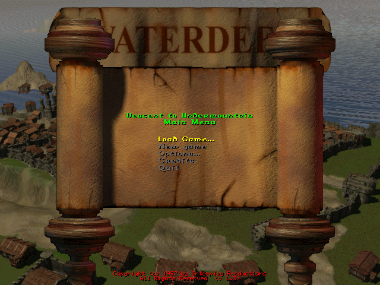
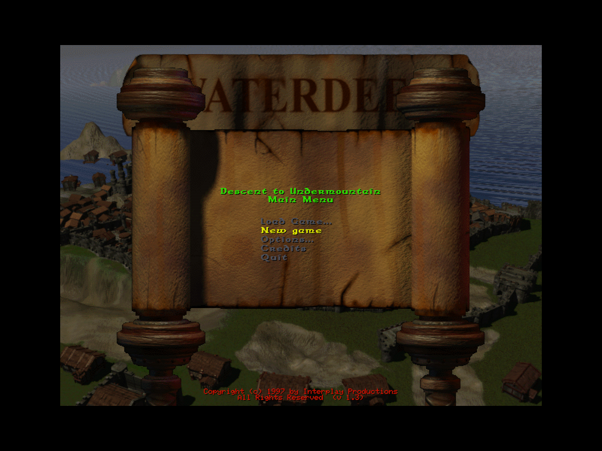
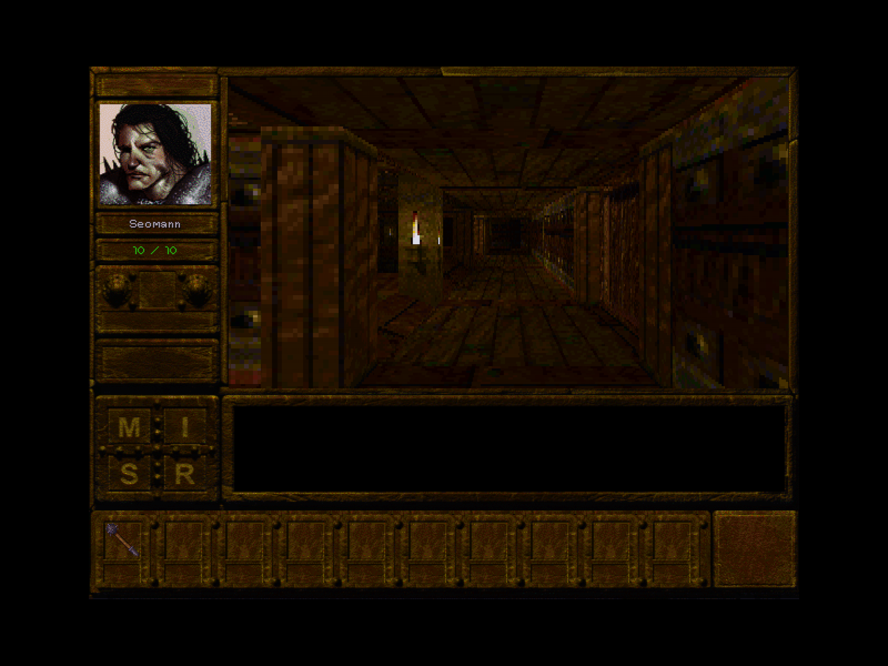
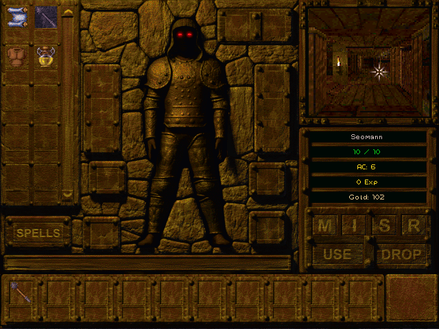

# Undermountain Enhanced – analyse en plan

Stand: 9 november 2026 (middag). Gebaseerd op de geïnstalleerde v1.3 in `DtU\` en de cd-bestanden in `_CD\DTU\_CDFILES`.

## 1. Wat er in DTUGAME.EXE zit

| Eigenschap | Waarde |
|---|---|
| Formaat | MZ-stub + **LE** (DOS/4GW), Watcom C/C++32 (runtime 1988-1995) |
| Object 1 (code) | basis 0x10000, 0x10B9EE bytes (~1,1 MB machinecode) |
| Object 2 (data/BSS) | basis 0x120000, 0x3706E0 bytes (waarvan het meeste BSS) |
| Entry / stack | obj 1 : 0xE2B0C (lineair 0xF2B0C) / obj 2 : 0x3706E0 |
| Fixups | 49.619, bijna allemaal 32-bit offsets (type 7), 2 selector-fixups. Alleen interne fixups, geen imports. Het image is dus volledig verplaatsbaar. |
| Debug-info | geen. Wel ~75 RCS-strings (`$Id: vecmat.asm 1.54 1995/01/31 ... matt $`) |

**De engine is Descent 1 (stand begin 1995) inclusief de editor-code.** De RCS-strings (vecmat, interp, ntmap, piggy, gamemine, texmap, key, joy, timer, ipx, serial, soscodec ...) komen één-op-één overeen met bestanden uit de in 1998 vrijgegeven Descent 1-broncode. Daarmee kunnen we een groot deel van de functies herkennen en benoemen. De RPG-laag (AD&D-regels, dialogen, AI, inventaris, frontend) is eigen Interplay-code zonder bron.

Hardware- en OS-afhankelijkheden (lineaire disassembly, dus indicatief):

| Wat | Aantal | Opmerking |
|---|---|---|
| `int 21h` (DOS) | ~113 | bestanden, geheugen, tijd |
| `int 31h` (DPMI) | ~68 | selectors, geheugen, interrupts locken |
| `int 10h` (video/VESA) | ~12 | VESA 320x200, 640x480, 800x600 (256 kleuren) |
| `int 2Fh`, `int 33h`, overige | enkele tientallen | MSCDEX (cd), muis, multiplex |
| `in`/`out` (poorten) | ~330 | VGA-palet, PIT-timer, toetsenbord, joystick, Sound Blaster |
| FS/GS-selectorladingen | ~150 | o.a. texture mapper (ntmap.c) en piggy.c gebruiken eigen selectors |
| FPU-instructies | ~2.800 | Watcom-floating point naast Descent's fixed point |

De vertraging van het Interplay-logo onder DOSBox komt door de timercode van het spel: het leest de status van PIT-teller 1 terug (dosbox-x issue #4991). In een native versie verdwijnt dat probleem vanzelf.

Nuttige opstartparameters in de exe: `-notitles`, `-nocd`, `-lowres`, `-nosound`, `-nomouse`, `-verbose`, `-nomonsters`, `-noobjects`, `-rinvul`, `-showaddress`, `-spewbm`.

## 2. Dataformaten

| Bestand | Formaat | Status |
|---|---|---|
| `*.COW` (op cd, één per levelgroep) | gecomprimeerde EGG's en BIN's; het spel pakt ze zelf uit naar de installatiemap | **werkt** in de headless-versie (HMC.COW → HMC.EGG) |
| `*.HEN` (op cd) | bron voor `*.BIN` (per level), ook door het spel uitgepakt | werkt |
| `*.EGG` (PORTAL, HMC, ...) | **Descent 1 PIG**: header (bitmaps, sounds, models), daarna DiskBitmapHeaders van 17 bytes. PORTAL.EGG: 3580 bitmaps, 121 geluiden, 58 modellen | bekend (DXX-Rebirth) |
| `*.LVL`, `*.LV2` | **Descent 1 RDL** (`LVLP`, versie 1) met DtU-uitbreidingen | grotendeels bekend |
| `*.FNT` | **Descent PSFN**-font | bekend |
| `*.SG` + `SAVE\` | Descent-savegame (`DGSS`) + per-level state | deels bekend |
| `*.MVE` | **Interplay MVE** (640x480) | bekend (ffmpeg, Fallout CE) |
| `PALETTE.256` | Descent-palet + fadetabellen (9472 bytes) | bekend |
| `*.TUN` | gestreamde digitale muziek (SMUS-streams), vermoedelijk SOS-ADPCM | uitzoeken |
| `FESTREAM.DAT`, `WERDZ.DAT`, `WHAMMO.DAT` + `.JRG` | streams/archieven (spraak, frontend, effecten) met indexbestand | uitzoeken |
| `*.BRN`, `*.SAY`, `*.TAP`, `*.TIG` | per level: AI (\"brain\"), tekst, en twee eigen tabellen | uitzoeken |
| `DTU.MSN`, `DTU.WRP`, `DTU.SNG`, `*.TEX`, `*.TBL` | platte tekst (levellijst, warps, cd-tracks, teksten) | leesbaar |
| `HMIDRV.386`, `HMIDET.386` | HMI SOS-geluidsdrivers, runtime geladen | wordt vervangen |

## 3. Gekozen aanpak: statische recompilatie

| Route | Oordeel |
|---|---|
| Emulatielaag zoals SWOTL Enhanced | Werkt in principe, maar vereist een 386-protected-mode-CPU met FPU op ~200 MIPS, plus DPMI, VESA en SB/HMI. Veel werk en verbeteringen blijven cosmetisch. |
| Native uitvoeren in een 32-bit Windows-proces (zoals HX DOS) | Snel, maar eigen LDT-selectors (FS/GS) werken niet onder 64-bit Windows (WOW64) en lage adressen (0xA0000) zijn niet gegarandeerd vrij. Te kwetsbaar. |
| **Statische recompilatie → native x64 + SDL3** | **Gekozen.** Bewezen op Watcom-LE-spellen (Albion, X-Com, Warcraft) met M-HT's open-source SR-tool (MIT/GPL/LGPL). Selectors, poorten en interrupts worden gewone functieaanroepen. Daarna kunnen functies één voor één door eigen C-code worden vervangen. |

### Architectuur

```
Originele DTUGAME.EXE ──(SR, eenmalig, bij de gebruiker)──> dtu-main (x64: win64 of elf64)
                                                              │
                ┌─────────────────────────────────────────────┤
                │  runtime/ (platformlaag, C)                  │
                │  - dos.c    int 21h → bestanden (C: = spel,  │
                │             D: = cd-map), MSCDEX (int 2Fh)    │
                │  - dpmi.c   int 31h → geheugen < 4 GB,        │
                │             selectors, vectoren, real-mode    │
                │  - video.c  VESA 1.2 gebankt, VGA-DAC, PNG    │
                │  - io.c     poorten, PIT 120 Hz, IRQ0/IRQ1,   │
                │             muis, headless-sturing            │
                │  - lowmem.c NULL-pointer-reads zoals DOS/4GW  │
                │  - x64/dtu-asm.asm  overgang C ↔ hercompileerd│
                │  - sdl/      SDL3-venster, VGA-CRT-shader,   │
                │             toetsenbord en muis (Windows)     │
                └─────────────────────────────────────────────┘
Later: geluid, MVE.
```

## 4. Fasering

1. **Toolchain en loader.** Klaar (8 november).
2. **Eerste beeld.** Klaar (9 november): het hoofdmenu, eerst headless op Linux en daarna als `DTU-Enhanced.exe` in een SDL3-venster met VGA-CRT-shader. Een savegame laden werkt tot in de kerker; alleen de texturen ontbreken nog.
3. **Speelbaar.** Toetsenbord en muis, timer, MVE-filmpjes (inclusief het Interplay-logo zonder vertraging), cd-loos spelen.
4. **Geluid.** SOS-API vervangen: effecten, gestreamde muziek (`.TUN`) en spraak.
5. **Enhanced.**
   - CRT-shader
   - hogere en widescreen-resoluties: de Descent-renderer is canvasgebaseerd, dus een extra VESA-mode is haalbaar
   - mouselook en gamepad
   - framerate los van de spellogica
   - bekende bugs fixen
   - eventueel een hardware-renderer met DXX-Rebirth als referentie

## 5. Open punten

- **Cd-inhoud (opgelost).** In `_CD\` staan drie images. DTU en DTU2 zijn identieke heruitgaven uit 2004, met de v1.3-update, DOSBox 0.61 en VDMSound. DTU3 is de originele USA-persing uit 1997 (Redump bin/cue, met EREGCARD). Er ontbreekt niets. De versie op schijf is v1.3, met een andere exe dan op de cd.
- **Juridisch.** De licentie verbiedt reverse engineering "except as permitted by law". De EU-softwarerichtlijn (art. 6) en de Auteurswet (art. 45m) staan decompilatie voor interoperabiliteit toe. Uitgangspunt: geen spelcode verspreiden; de recompilatie draait bij de gebruiker op diens eigen exe.
- **`loc_1151E0`** (Watcom-printf voor floats, `%f`) staat bewust buiten de recompilatie: als code markeren laat SR doorlopen in de tabel met machten van tien erachter. Opgelost in 0.2.12: de functie is vervangen door C-code.
- **`SAVE\`-map.** In de testkopie ontbrak `SAVE\`, waardoor `CSUF.ls` niet aangemaakt kon worden. Bij de echte installatie bestaat die map wel.
- **Geluid (opgelost in 0.2.13).** De SOS-driver HMIDRV.386 wordt niet meer geladen; `runtime/sos.c` vervangt hem.

## 6. Voortgang

### 8 november 2026: recompilatie lukt

**Toolchain.** De Windows-exe wordt in de Linux-werkomgeving gebouwd. Daarvoor gebruiken we clang 18, lld en nasm uit de werkomgeving, plus drie bestanden uit `DtU\_tools`: de MSYS2-mingw64-tree, `SDL3-devel-3.4.20-mingw` en `SR-master`. `DTU.Enhanced/setup-toolchain.sh` zet alles in één keer opnieuw op.

**SR.** De recompiler is gebouwd met x64-uitvoer, met een kleine patch (`third_party/SR/sr-dtu.patch`) voor `scasw`/`scasd`, `iretd` (wordt `RET 8`), `jecxz`/`jcxz`, `popfw` en `outsb`.

**Resultaat.** De machinecode is vertaald naar x64-assembler en assembleert tot één object. De 36 adressen van **zelfmodificerende code** (0x10CD96 t/m 0x111176) horen bij de Interplay MVE-videodecoder; dat worden dummy-schrijfbuffers tot de MVE-speler vervangen is.

### 9 november 2026: hoofdmenu in de headless-versie



**Linux-testversie.** `build-headless.sh` bouwt in één stap SR, de recompilatie (nu als ELF64) en de runtime tot `dtu-headless`. Netwerk is niet nodig: alles komt uit `DtU\_tools`. Het programma draait het spel zonder venster, logt elke DOS-, DPMI- en VESA-aanroep en schrijft PNG-schermafbeeldingen. Opties: `--seconds`, `--shots`, `--key T:scancode` (toetsaanslagen op een tijdstip). Na ~3 seconden staat het hoofdmenu er; twee keer pijl-omlaag selecteert *Options...*, dus de toetsenbord-IRQ werkt.

**Wat er aan de recompilatie veranderde:**

| Probleem | Oplossing |
|---|---|
| SR begint niet bij het LE-entrypoint; de Watcom-opstartcode (`cstart_`) en alles wat alleen daarvandaan bereikbaar is, bleef data | `global_aliases.sci`: `loc_F2B0C,dtu_cstart`. De runtime start het spel via de echte Watcom-opstartcode, zodat de C-bibliotheek (heap, stdio, `_InitRtns`) normaal initialiseert. |
| ~15% van de code bleef als `db`-bytes staan: functies die alleen via functiepointers in code bereikt worden (callbacks, jump tables in onvertaalde functies). Uitvoeren daarvan gaf crashes. | `fixup_interpret_as_code.sci` met **291 extra startpunten**. Gevonden met `tools/classify.py` + `gen_iac.py` (doelen van code→code-fixups die als adres gebruikt worden en op code lijken), en opgeschoond met `autofix.py`/`sr_bisect.py`. Wat data bleek, staat in `data_in_code.txt`. Nu nog ~100k `db`-regels, vooral editorcode, tabellen en tekst. |
| `cstart_` leest PSP en environment via selectors | Vier `instruction_replacements`: de runtime bouwt een nep-PSP (0x10000) en een DOS-environmentblok; cstart leest die flat. |
| `lar`/`lsl` (selectorrechten) | vervangen door constanten (4 GB limiet) |
| Far calls naar de runtime-geladen HMI-driver (9×) | vervangen door een pseudo-interrupt naar de runtime (`x86_int` met nummer 0x1000000+adres); geeft nu een foutcode terug |
| `mov ax, DGROUP` (de 2 selector-fixups) in twee interrupt-handlers | `mov ax, 0` |
| Watcom `int386()`/`intr()` springen in een tabel `int N; ret` | doorverwezen naar `dtu_int_dispatch` in de runtime |
| macro's `OUTSB_1`/`REP_OUTSB` gebruikten de native stack | herschreven op de geëmuleerde x86-stack |

**De runtime** (`runtime/`, ~1.700 regels C plus asm-glue):
- Geheugen: conventioneel geheugen en het VGA-venster liggen op hun DOS-adressen (0x10000–0x10FFFF), DPMI-geheugen onder 4 GB. Het code- en datasegment liggen vanaf 0x10000000.
- **NULL-pointers.** Onder DOS/4GW is adres 0 gewoon leesbaar (de interrupttabel), en DtU leunt daarop: het leest velden van nog niet bestaande objecten. Moderne systemen kunnen pagina 0 niet mappen. `lowmem.c` vangt zo'n toegang af, laat het basisregister één instructie lang naar een 64 KB vervangbuffer wijzen en zet het daarna terug. Bij het opstarten gebeurt dat honderden keren, verspreid over een handvol plekken in de code.
- DOS-bestanden: C: is de spelmap, D: de cd-map, hoofdletterongevoelig. MSCDEX met een nep-apparaatdriver; de cd-controle van het spel slaagt.
- Video: VESA 1.2 met 64 KB-banks (modus 101h, 640x480), VGA-DAC-palet.
- Timer: het spel zet de PIT op 120 Hz en installeert IRQ0- en IRQ1-handlers; die roept de runtime aan vanuit de vertaalde code (`SR_CheckTimer`).

**Wat het log laat zien over het spel:** het vraagt VESA-info, zet eerst 320x200 en daarna 640x480, pakt `HMC.COW` en `HMC.HEN` van de cd uit naar `HMC.EGG`/`HMC.BIN`, laadt `PORTAL.EGG`, de fonts, `WERDZ.DAT` en de `FE*`-frontendbestanden, en verwijdert bij het opstarten oude uitgepakte levelbestanden (`*.EGG`, `*.BIN`, `*.LVL` behalve het huidige).

### 9 november 2026 (2): DTU-Enhanced.exe met SDL3-venster



**Bouwen.** `build-windows.sh` maakt in één stap `DTU-Enhanced.exe` plus `SDL3.dll`, met clang, lld en de mingw64-tree uit `DtU\_tools`. Getest vanuit een lege map. De Linux-variant (`build-headless.sh`) gebruikt dezelfde runtime.

**Getest onder Wine** (Windows-compatibiliteitslaag) met een virtueel scherm en Mesa-OpenGL in de werkomgeving:
- het hoofdmenu verschijnt in het venster, met de VGA-CRT-shader (scanlines, VGA-kleuren);
- toetsenbord: pijltjes en Enter werken, het Options-menu en de lijst met savegames openen;
- **Quit** sluit het spel en het venster netjes af;
- een savegame laden (Yawning Portal Inn) brengt je in de kerker: HUD, portret en 3D-geometrie zijn er, maar **de muren zijn wit** (zie volgende stap).

**Wat er voor Windows nodig was:**

| Probleem | Oplossing |
|---|---|
| De hercompileerde code gebruikt 32-bit adressen, dus de exe moet onder 2 GB liggen. Windows (en Wine) zet dan zijn eigen heaps en de stack van de hoofdthread in de eerste megabyte, precies waar DOS-geheugen en het VGA-venster horen. | De exe ligt op image base 0x20000 en bevat zelf een sectie `.dosmem` van 1 MB, die 0xA0000–0xBFFFF dekt. Het image wordt als eerste gemapt, dus niets anders kan die adressen innemen. PSP, environment, DOS-geheugenblokken, VESA-teksten en de nep-cd-driver zijn naar 0xB0000–0xBFFFF verhuisd (het ongebruikte monochrome-videogebied). Het buildscript controleert de ligging. |
| Signals bestaan niet op Windows | `fault.c`: vectored exception handler voor de NULL-pointer-afhandeling en crashrapporten (met een melding in een venster). |
| Win64-aanroepconventie | `dtu-asm.asm` heeft nu een win64-variant met unwind-info, naar het voorbeeld van M-HT's Albion-port. |
| Het spel eist ~300 KB vrij conventioneel geheugen (eis van de DOS-geluidsdrivers) | We melden 512 KB vrij; het spel gebruikt er in de praktijk ~2 KB van. |

**Threads.** De hoofdthread beheert het venster (events en tekenen met vsync), het spel draait in een eigen thread en een derde thread levert de PIT-timer. Toetsen gaan als XT-scancodes (met E0-prefix voor pijltjes enzovoort) naar de eigen IRQ1-handler van het spel. De muis gaat via int 33h, maar het menu gebruikt geen muis.

**Instellingen** in `dtu-enhanced.ini` naast de exe (wordt bij de eerste start aangemaakt):
- `fullscreen`, `width`, `height`;
- `shader` = `crt-auto` / `crt-1080p` / `crt-1440p` / `crt-4k` / `none`. Alleen de VGA-varianten van DOSBox Staging: 640x480 met `vga-1080p` of crt-hyllian (VGA-presets), 320x200 met de fake-double-scan-shader. De EGA-monitoremulatie uit CAULDRON is eruit;
- `scale`, `aspect`, `vsync`;
- `args` (standaard `-notitles -nosound`) en `cd_path` (leeg = `_CD\DTU\_CDFILES` naast de exe).

Toetsen: Alt+Enter of F11 schakelt volledig scherm, Ctrl+F12 maakt een schermafbeelding. Een log staat in `dtu-enhanced.log`.

**Nog twee vertaalfouten gevonden en opgelost.** Bij het afsluiten crashte het spel. Oorzaak: twee fouten in mijn script dat functiepointers zoekt.
- Het telde `lea eax, [functie]` als geheugentoegang, niet als adres.
- Python ziet Latin-1-bytes zoals é en ÿ als letters, waardoor echte code als "tekst" werd overgeslagen.

Na het herstel zijn er 306 extra startpunten (was 291) en sluit het spel normaal af.

**Eerste test op echt Windows** (Vincent, RTX 4070 Ti): de exe laadt op image base 0x20000, OpenGL 3.3 werkt, het spel komt tot het laden van `HMIDRV.386`. Daar crashte het: de HMI SOS-driver is DOS-code die het spel zelf laadt en via far calls aanroept. Zeven van die far calls (`call far [ebp+8]` in 0x102DE7–0x103147) had de recompiler vertaald als een aanroep van de functie zelf, met eindeloze recursie en een stack overflow tot gevolg. In mijn testkopie ontbrak `HMIDRV.386`, dus die route was niet getest. Opgelost: de runtime doet alsof `HMI*.386` niet bestaat (het spel draait dan zonder geluid verder), en alle far calls naar de driver gaan via de runtime.

**Versienummer.** Vanaf 0.2.1 staan versie en bouwtijd (UTC) in de venstertitel, op de eerste regel van `dtu-enhanced.log` en in de bestandseigenschappen van de exe (Details). Het nummer staat in `runtime/version.h`. Aanleiding: bij de tweede test draaide nog de vorige exe, waarschijnlijk teruggezet door OneDrive. De oude versie heet 0.2.0, die met de HMI-fix 0.2.1.

### 9 november 2026 (3): versie 0.2.2 – texturen en snelheid



Vincent bevestigde op echt Windows (0.2.1): menu's en het laden van een savegame werken, maar de muren waren wit en het beeld was traag.

**Texturen (segmentregisters ES, FS, GS).** De texture mapper laadt eigen selectors in FS/GS (DPMI-descriptors waarvan de basis naar een textuur wijst) en leest dan `fs:[ecx]`. De recompiler laat segmenten weg. Nu:
- de runtime houdt van elke selector de basis bij in `dtu_sel_base[65536]` (bijgehouden door de DPMI-functies die selectors maken of verzetten);
- `dtu_es/fs/gs_sel` en `dtu_es/fs/gs_base` bevatten de huidige waarden;
- `tools/gen_fsgs.py` loopt met capstone alle vertaalde code door en maakt een `instruction_replacement` voor elke selectorlading (`mov fs, ...`, `push/pop`, `lfs/lgs/les`), elke opslag van een selector en elke geheugentoegang met `fs:`, `gs:` of een expliciet `es:`-prefix. Dat zijn 1486 regels, herkenbaar aan `; fsgs` en opnieuw te genereren. Alleen r9/r10 worden gebruikt en de vlaggen blijven intact. Bij instructies met AH/BH/CH/DH (die niet samen met r9/r10 te coderen zijn) leent het script tijdelijk een ongebruikt register.
- Drie `call/push/jmp` met een `es:`-operand zijn overgeslagen (0x11B956, 0x11B95A, 0x11B96D); die komen in de test niet voor.

**Snelheid.** De traagheid kwam van NULL-pointer-lezingen die per frame gebeuren. Elke lezing kost een uitzondering plus een single-step (op Windows twee keer de vectored exception handler). In 40 seconden spel waren het er **~207.000**, nu **67** (alleen tijdens het laden). De runtime telt ze per plek en zet de drukste in de log. De oorzaken:

| Plek | Wat het spel doet | Oplossing |
|---|---|---|
| 0xDA3E4 | Toetsenbordbuffer van de BIOS legen (0040:001A = 0040:001C), elke keer dat het toetsenbord wordt gelezen: ~92.000× | Die buffer gebruiken we niet: lezen/schrijven vervangen door niets |
| 0x1BBC2 | `strtok` levert elk frame NULL; daarna `cmp byte [eax],'@'` en `strcmp(NULL, ...)` | Een NULL-pointer wordt daar een lege string (`dtu_zero_page`); de NULL zelf blijft bewaard, want latere code test erop |
| 0x10148 | Functie wordt elk frame met een NULL-object aangeroepen en leest byte 0x142 | Adres onder 0xA0000 leest de nul-byte zonder uitzondering |

Onder DOS lazen deze plekken gewoon de interrupttabel in het eerste geheugen; het gedrag blijft dus gelijk. De headless-variant tekent nu ~300 frames per seconde in de kerker (zonder vsync).

**Getest:** headless (menu, savegame laden, afsluiten) en onder Wine met venster en shader (savegame laden, texturen zichtbaar). De `int 3`-meldingen in de log zijn onschuldig: debughaken van de Watcom-runtime die de runtime negeert.

### 9 november 2026 (4): versie 0.2.3 – muis



Vincent bevestigde dat 0.2.2 op Windows snel genoeg is en de texturen toont.

**Waarom de muis niet werkte.** Het spel controleert eerst of er een muisdriver is: reset (int 33h functie 00h) en daarna "driver aanzetten" (functie 20h), die AX=FFFFh moet teruggeven. Onze emulatie gaf dat niet terug, dus dacht het spel dat er geen muis was. Na de fix gebruikt het spel:
- 0Ch: een eigen event-handler (0xE84D0) voor knoppen indrukken en loslaten (masker 7Eh). De runtime roept die aan vanuit de speldraad, net als de timer- en toetsenbordinterrupts. Het is een far-procedure die eindigt met `retf` (vertaald als `RET 4`), dus de nieuwe helper `dtu_c_call_mouse` zet eerst een cs op de stack;
- 0Bh: relatieve beweging (mickeys). Het spel telt die 1:1 op bij zijn eigen cursor (0x547E4), of draait er het beeld mee;
- 07h/08h/04h: bereik 0–639 × 0–479, startpositie 300,240.

**Twee modi in het spel** (handleiding): *Immersive* (standaard), waarin de muis het beeld draait, en *Non-Immersive*, waarin de muis een cursor bestuurt waarmee je op de knoppen klikt (M, I, S, R, USE, inventaris). De toets **V** wisselt. In menu's beweegt de muis de selectie op en neer, en een klik kiest.

**Muis vangen.** Omdat het spel een eigen cursor tekent en alleen relatieve beweging leest, vangt het venster de muis (relatieve modus van SDL), net als DOSBox. **Ctrl+F10** laat de muis los; een klik in het venster vangt hem weer. Als het venster de focus verliest, wordt de muis ook losgelaten. Eén gamepixel per pixel van het beeld in het venster; instelbaar met `speed` onder `[mouse]` in `dtu-enhanced.ini` (alleen in een nieuw aangemaakt ini-bestand staat de regel al, maar je kunt hem zelf toevoegen).

**Getest:** headless met een script (`--mouse T:X,Y,B`): menu, het beeld draaien, V, de inventaris openen met een klik. Onder Wine: vangen, bewegen en klikken komen bij het spel aan. Hoe snel de muis op een echte pc aanvoelt, moet nog blijken.

### 9 november 2026 (5): versie 0.2.4 – spelklok, fps-limiet en fps in de titel

Vincent merkte op echt Windows: vooruit lopen gaat trager dan in DOSBox en je glijdt door na het loslaten, draaien met de pijltjestoetsen gaat in grote, schokkerige stappen, en omhoog/omlaag kijken met de muis is minder gevoelig.

**Oorzaak 1: de spelklok sprong terug.** DTU meet tijd nauwkeuriger dan de 120 Hz-timer: het aantal timerinterrupts (bijgehouden door zijn IRQ0-handler op 0x149C3B) maal de reload, plus de lopende teller van PIT-kanaal 0, plus één periode als de PIC een wachtende interrupt meldt (IRR, via OCW3 0Ah op poort 20h). Zo meet het de frametijd (0x40E91) en hoe lang een toets is ingedrukt (0xDA5AC, gebruikt voor lopen en draaien). Onze emulatie nam de teller uit de klok van de pc, maar de interrupts komen met een kleine vertraging bij het spel aan (pas op het volgende controlepunt in de vertaalde code). Daardoor sprong de spelklok vaak ongeveer 8 ms terug. Nu kiest de runtime de teller en het IRR-bit zo dat de uitkomst de echte tijd volgt, past bij de interrupts die het spel al heeft geteld en nooit afneemt. Herhaalde testruns (0,5 s naar links draaien) gaven eerst steeds een andere hoek, nu dezelfde.

**Oorzaak 2: geen framelimiet.** DTU begrenst de frametijd tussen 1/150 s en 1/5 s (0x40F1A). Boven 150 fps loopt de spelwereld dus sneller dan de echte tijd. Zonder limiet haalden we 300 fps of meer.

**Frame-hook.** Vlak voordat het spel per frame de tijd meet (0x40EAF), roept de vertaalde code nu `SR_FrameHook` aan:
- wacht tot het volgende frame aan de beurt is (limiet);
- telt de frames en meet de fps;
- levert wachtende timerinterrupts af, zodat de tijdmeting direct klopt.

**Instellingen** in `dtu-enhanced.ini`, onder `[video]`:
- `fps_limit = 60` (standaard; 0 = geen limiet, niet aan te raden boven 150);
- `show_fps = 1`: zet de fps in de venstertitel, bijvoorbeeld "Undermountain Enhanced 0.2.4 (...) - 60 fps (limit 60)". In de menu's komt het spel niet langs de frame-hook, daar staat alleen de naam.

Headless: `--fps N`. Verder logt de runtime de `int 3`-meldingen van het spel nog maar tien keer. Dat zijn debugcontroles van de ontwikkelaars, bijvoorbeeld bij een frametijd van 0. Zonder limiet gebeurde dat na het laden ruim 200.000 keer.

**Muisgevoeligheid omhoog/omlaag:** nog niet onderzocht. Eerst kijken of het met de juiste klok en framerate nog verschilt met DOSBox.

### 9 november 2026 (6): versie 0.2.5 – timerinterrupts niet meer weggooien

Vincent zag in 0.2.4: als je een looptoets iets langer indrukt, schiet je in een flits ver naar voren en soms opzij.

**Oorzaak: weggegooide timertikken.** Als er een tik klaarstond terwijl het spel interrupts uit had (`cli`), gooide de runtime die tik weg. Een echte PIC houdt hem vast tot `sti`. DTU doet bij elke tijdmeting `cli` (0xDFAE0) en het controlepunt van de recompiler ligt precies op die aanroep, dus er gingen voortdurend tikken verloren. De tikteller van het spel liep dan achter, de klokcorrectie van 0.2.4 liet de tijd stilstaan, en daarna haalde hij de achterstand in één keer in. Toetsen die in die tijd ingedrukt waren, kregen zo in één frame een flinke tijd mee. Nu blijven tikken wachten tot de interrupts weer aan staan, net als in de PIC.

**Twee bijkomende fixes:**
- Na het herprogrammeren van de PIT begint onze tikteller opnieuw. De nieuwe vergelijking zag dat als een negatieve achterstand en wachtte eindeloos. Nu begint de teller dan gewoon opnieuw.
- Het spel leest de PIT op twee manieren. De klokfunctie (0xDFA7A) latcht de teller en leest daarna het IRR. Een joystickroutine bij het opstarten (0x101B10) leest alleen de ruwe teller en wacht, met interrupts uit, tot die genoeg is afgelopen. Op poort 201h antwoordt de runtime dat er geen joystick is. De ruwe teller loopt nu weer vrij op de echte tijd. De correctie van 0.2.4 gebeurt alleen nog bij het klokpatroon (latch gevolgd door een IRR-leesactie), en verandert dan de gelatchte waarde.

**Diagnose in de log:** elke 5 s een regel `[frame]` met de frametijd die het spel zelf meet (minimum, gemiddelde, maximum en hoe vaak die buiten het bereik viel). Verder meldingen `[clock]` en `[irq]` als de klok bij moet sturen of als tikken te laat zijn.

**Resultaat:** headless en onder Wine is de frametijd bij een limiet van 60 stabiel rond 16,7 ms (onder Wine tussen ongeveer 9 en 25 ms). Drie keer 1 s vooruitlopen geeft precies hetzelfde beeld. Zonder limiet zit de frametijd vast op 6,7 ms, de ondergrens van het spel, en loopt de spelwereld dus te snel.

### 11 november 2026: versie 0.2.6 – lopen even snel als in DOSBox

Vincent vergeleek dezelfde route in twee video's: DOSBox (200000 cycles) en 0.2.5 met `fps_limit = 70`. In 0.2.5 liep hij duidelijk langzamer.

**Hoe DTU loopt** (0x53320–0x53470 en 0x540F0):
- Elk frame telt het spel de tijd dat de looptoets dat frame is ingedrukt (0xDA5AC), gedeeld door 8, op bij de snelheid (0x1E9A70).
- Die snelheid wordt per frame begrensd op de frametijd (0x13CD2C).
- De positie schuift per frame op met die snelheid (0x18ACF).
- Laat je de toets los, dan is de snelheid meteen 0.

Op topsnelheid loop je dus precies "frametijd per frame", ongeacht de framerate, zolang de frametijd die het spel meet regelmatig is.

**Wat er misging.** Onze log van Vincents sessie liet bij 70 fps frametijden zien die wisselden tussen 6,7 ms en 22,6 ms (gemiddeld wel 14,3 ms). Door de begrenzing per frame bleef de snelheid steeds hangen op de korte frames, en zo liep je ongeveer half zo snel. Twee oorzaken:
1. De klokcorrectie van 0.2.4/0.2.5 had een vrije verschuiving die geleidelijk tot een volle periode uit fase raakte. Dan liep de klok één frame een tik achter en het volgende frame weer bij. Nu wordt de fase gemeten vanaf het tijdstip waarop de laatst afgeleverde tik viel. Gecontroleerd: tikteller van het spel min afgeleverde tikken is constant, en de fase loopt per frame precies 1/70 s op.
2. Na het wachten van de limiter levert de runtime de timertikken af. Daarbij draait spelcode (de timercallbacks), die per keer een paar ms anders duurt. De frametijdmeting die direct na de frame-hook volgt, krijgt daarom nu het ideale starttijdstip van de limiter mee in plaats van "nu".

Verder levert de runtime bij een achterstand nu tot 60 tikken af (was 8), zodat de tikteller van het spel niet blijvend achterloopt.

**Resultaat:** headless meet het spel bij 20/35/70 fps frametijden van 50,0/28,6/14,3 ms zonder spreiding. Onder Wine zitten er af en toe uitschieters in (gemiddeld exact). De frame-hook, het lopen en de muisklik zijn opnieuw getest.

**DOSBox ter vergelijking:** in Vincents DOSBox-video verandert het beeld bij ongeveer 2 van de 3 videoframes (30 fps). Het spel zelf draaide daar dus rond 20 fps. Fraps meet de 70 Hz van het DOSBox-venster, niet de frames van het spel. Bij 20 fps loopt DTU ook bij ons iets verder in dezelfde tijd dan bij 35–70 fps; dat zit in het spel zelf (de optrekfase duurt 8 frames).

**Mogelijke snelheidsoptie:** een factor voor de impuls per frame en de begrenzing op 0x540F0 zou lopen sneller of trager maken. Draaien met de toetsen (0x1E9A6C) en de muis (`[mouse] speed`) hebben eigen knoppen.

### 11 november 2026 (2): versie 0.2.7 – klok bij geluidsinstelling, toetsvertraging

Vincent zag in 0.2.6 op Windows nog steeds traag lopen (video bij 70 fps). Bij 20 fps liep hij schokkerig en bewoog hij nog lang door na het loslaten van de toets. Zijn log bij 20 fps: frametijd gemiddeld 13 ms in plaats van 50 ms.

**Oorzaak 1: de HMI-timerdienst.** Vincents `DTU.CFG` (gedeeld met DOSBox) heeft een geluidskaart: `DigiDeviceID=0x1` en `0xe018`; de laatste waarde telt. Met geluid laat DTU zijn 120 Hz-klok lopen via de timerdienst van de HMI SOS-driver. De klok wordt dan na het Interplay-logo (LOGO22S.MVE, speelt ook met `-notitles`) niet opnieuw op 120 Hz gezet. Die stap staat op 0xB858E en draait alleen zonder geluid: 0x13ACD8 < 1. Omdat wij `HMI*.386` verbergen, bleef de PIT na het filmpje op 18,2 Hz staan (log: `[pit] ... 65536 -> 18.21 Hz`). De IRQ0-handler van het spel telde daardoor met de verkeerde reload, en de spelklok liep veel te langzaam en schokkerig. In mijn tests had `DTU.CFG` geen geluid en ontbraken de filmpjes, dus het kwam daar niet voor.
- Fix (vervanging op 0x2BBCC): na het inlezen van de configuratie zet de runtime 0x13ACD8 (geluidsapparaat) op 0. De kopie in 0x13AA86, waaruit `DTU.CFG` bij het afsluiten wordt geschreven, blijft de echte waarde houden. DOSBox houdt zo zijn geluid. Als er later geluid komt, moet dit terug.
- Gereproduceerd met Vincents `DTU.CFG` en LOGO22S.MVE (headless `run2.sh` met `PRISTINE=pristine-snd`): na het filmpje staat de PIT weer op 120 Hz. De frametijd is 50,0 ms bij 20 fps en 14,3 ms bij 70 fps.

**Oorzaak 2: één toetsbyte per controlemoment.** De runtime gaf per aanroep van `dtu_run_timer` maar één scancode-byte aan het spel. Bij een lage framerate slaapt de speldraad het grootste deel van het frame in de limiter, terwijl Windows een ingedrukte pijltjestoets zo'n 30 keer per seconde herhaalt, telkens twee bytes. De wachtrij groeide, en de "losgelaten"-code kwam pas seconden later aan. Nu levert de runtime alle wachtende bytes af, één IRQ1 per byte, en alleen als de interrupts aan staan (vroeger zette de toetsenbordlevering IF ongevraagd op 1). Test: na het loslaten van een 2 s ingedrukte toets staat het beeld bij 20 en 70 fps binnen ongeveer 0,3 s stil.

Extra diagnose: `[irq] interrupts disabled for 0.5 s (stack …)` als IF lang 0 blijft, en bij `[clock] ... late` staan nu IF, de tikteller van het spel en de afgeleverde tikken.

### 11 november 2026 (3): versie 0.2.8 – strafen onafhankelijk van de framerate

Vincent: lopen is met 0.2.7 sterk verbeterd, maar strafen (zijwaarts lopen) gaat nog langzamer dan in DOSBox.

**Toetsen** (bindingstabel op 0x13C1A5, 22 bytes per slot, primaire en secundaire toets om en om): A (slot 11) en D (slot 13) zijn zijwaarts lopen. Elk frame telt het spel tijd × snelheid op bij 0x1E9A74. Vooruit/achteruit (pijltjes, W/X) zet 0x1E9A7C. De spelerupdate (0x2C020) telt beide via de looprichting op bij de snelheid van de speler (ebp+0x108…).

**Oorzaak:** als er geen vooruit-invoer is (0x1E9A7C = 0), deelt het spel de spelersnelheid elk frame door 3 (0x2C02E–0x2C079). Bij strafen zonder vooruitlopen werkt die afremming dus elk frame, en daardoor hangt de eindsnelheid af van de framerate. Hoe meer frames per seconde, hoe trager je strafet. In DOSBox draaide het spel rond 20 fps.

**Fix:** de vier `idiv ebx` (delen door 3) zijn vervangen door vermenigvuldigen met `dtu_friction`/65536, afgerond naar 0 net als `idiv`. De frame-hook zet `dtu_friction` op f = 1 − dt/(1,5·dt0), met dt0 = 1/`physics_fps`; ondergrens 1/3, bovengrens 0,98. Zo is de evenwichtssnelheid a·dt/(1−f) bij elke framerate gelijk aan die van het origineel bij `physics_fps`.
- Instelling `physics_fps` onder `[game]` in `dtu-enhanced.ini`: standaard 20 (zoals DOSBox op een snelle pc), 0 = origineel gedrag (1/3 per frame). Headless: `--physics-fps N`.
- Test (1 s A ingedrukt): origineel bij 20 fps en de nieuwe versie bij 20, 35 en 70 fps komen even ver; het origineel bij 70 fps duidelijk minder ver.

### 12 november 2026: versie 0.2.9 – menutoetsen

Vincent: toetsen die een scherm openen (Tab automap, S statistieken, I inventaris) laten het scherm snel wisselen tussen spel en menu. Dat deed het origineel ook, maar bij de hogere framerate valt het meer op. Hij vroeg om het aan de functie te koppelen en niet aan de toets, omdat toetsen via F2 te hermappen zijn.

**Hoe het spel deze toetsen leest.** De 3D-lus (0x53D20 e.v.) kijkt elk frame of de toets van een functie ingedrukt is (0x467B40 + code), via de bindingstabel op 0x13C1A5. Voor de automap zijn dat slots 38/39 (0x13C4E9/0x13C4FF). Is hij ingedrukt, dan opent het spel het scherm (automap 0x408F5). Het scherm zelf sluit weer zodra het de toets ingedrukt ziet. Houd je de toets vast, dan gaat het dus heen en weer. Herhaalde toetsaanslagen (typematic) versterken dat nog.

**Fix in de runtime** (`menu_key_filter` in io.c, op het moment dat een scancode aan IRQ1 wordt gegeven):
- Bij elke druk zoekt de runtime de code op in de actuele bindingstabel van het spel, ook na hermappen met F2. Het prefix E0 hoort bij de code: CB = E0 4B.
- Bewegings-, draai-, kijk-, strafe- en modifierfuncties (slots 4–21, 24–37, 41–42) en toetsen zonder functie gaan ongewijzigd door.
- Voor de overige functies (automap, inventaris, statistieken, rusten, modus, ren-toggle, …):
  - herhalingen worden niet doorgegeven;
  - een nieuwe druk binnen `menu_key_delay` ms (standaard 300) na de vorige druk op dezelfde functie wordt genegeerd, samen met het loslaten. Primaire en secundaire toets delen één timer;
  - het spel krijgt de toets na 0,1 s als losgelaten te zien, ook als je hem nog vasthoudt. Het echte loslaten wordt dan niet meer doorgegeven.
- Instelling `menu_key_delay` onder `[game]` (0 = gedrag zoals in DOS). Headless: `--menu-key-delay N`. Met `DTU_VERBOSE=2` logt de runtime elke toets en elke beslissing van het filter.

**Getest:** headless: Tab of I 1,5 s vasthouden opent het scherm en het blijft open; een tweede druk sluit het; een druk binnen 300 ms wordt genegeerd. Onder Wine met echte SDL-herhalingen: I vasthouden houdt de inventaris open. Tab bereikt het spel onder Wine/Xvfb niet, ook niet met 0.2.8; dat ligt aan de testopstelling.

**Kanttekening (opgelost in 0.2.10):** letters die aan een functie gekoppeld zijn, volgden deze regels ook bij het intikken van een naam.

### 12 november 2026 (2): versie 0.2.10 – menutoetsen per frame

Vincent: in 0.2.9 wisselt het beeld bij een druk op Tab of S nog steeds even snel heen en weer, en blijft het daarna staan. Hij vroeg: eerst wisselen, dan pas de timer laten lopen. En graag een uitzondering voor typen (naam van een savegame, karaktergeneratie).

**Wat er echt gebeurt.** Automap, statistieken en inventaris zijn geen aparte schermen met een eigen lus, maar modi van de hoofdlus. Tab roept bijvoorbeeld 0x408F5 aan: is de modus ([0x13B616]) 4 (automap), dan gaat het spel terug naar de vorige modus ([0x13B61A]), anders wordt het modus 4. De hoofdlus kijkt elk frame of de toets ingedrukt is en wisselt dan. In 0.2.9 bleef de toets 0,1 s "ingedrukt", dus 6 frames bij 60 fps, en het beeld wisselde 6 keer.

**Nieuwe aanpak** (`menu_key_filter`, io.c):
- Een druk op een menufunctie wordt doorgegeven bij het begin van een frame, in de frame-hook vóór de toetscontrole van de hoofdlus. Bij het begin van het volgende frame volgt het loslaten. Het spel ziet de toets dus in precies één frame en wisselt één keer. Andere toetsen die in de wachtrij achter zo'n druk staan, wachten hooguit één frame.
- Daarna geldt de minimale tussentijd per functie (`menu_key_delay`, standaard 300 ms). Herhalingen worden niet doorgegeven, en het echte loslaten ook niet.
- Het filter werkt alleen terwijl de hoofdlus draait: de frame-hook moet minder dan 0,15 s geleden zijn aangeroepen. Het Esc-menu (opslaan, laden) en de menu's buiten het spel (karaktergeneratie, hoofdmenu) draaien niet in de hoofdlus, dus daar werkt typen normaal. Getest: een savegame-naam "sssiii" snel intikken komt volledig door.
- Reserve: lopen er geen frames meer, dan volgt het loslaten na 0,25 s.

**Getest** (headless, schermwissels per frame gemeten): Tab, S en I 0,5 s vasthouden geeft één wissel, een tweede druk sluit, een druk 0,1 s later wordt genegeerd, en 2 s vasthouden geeft één wissel. Onder Wine met echte toetsherhalingen: S vasthouden opent de statistieken, die blijven staan, en een volgende druk sluit ze.

### 12 november 2026 (3): versie 0.2.11 – leveltest

Doel: elk level laden en er even rondlopen, om crashes en vertragingen te vinden (Vincent herinnerde zich klachten over vertraging in level 2).

**Methode** (`tools/levtest.sh N`, samenvatting met `tools/levsum.py`): byte 41 van SG0.SG is het level (+1, volgorde van DTU.MSN). Met een gepatchte SG0 laadt "Restore" dat level vanaf het begin. Per level 40 s headless bij 60 fps: laden, 3 s vooruit, draaien, strafen, terug. De log geeft per 5 s de frametijd en de rekentijd van het spel per frame (zonder de wachttijd van de limiter).

**Resultaat (33 levels):**
- 31 levels laden en draaien. Het spel rekent 2–9 ms per frame (headless, één run tegelijk); 60 fps is overal haalbaar. **Kobold Lair (level 2) heeft geen vertraging.**
- madlands en playgrnd (levels 28 en 31) staan niet op de cd: het spel stopt met "Error:" en wat onleesbare tekens. Dat komt uit het spel zelf: deze aanroepen van Error (0xD7BB4) geven de tekst in een register mee, maar Error leest hem van de stack en drukt dus de bytes achter het terugkeeradres af. In het origineel gebeurt hetzelfde.
- Bij bones, bat, thief2, mine, myrkul, drow1, drow3, beholdr2 en flame gaat het level-1-personage dood (Death Menu, gecontroleerd met schermafdrukken).
- Haperingen van 200 ms in drow2 en ibbalar zijn een levelovergang en een dialoog, geen rekenwerk.

**Gevonden en opgelost:**
- **Delen door nul** (ibbalar2, ook drow2/drow3): `idiv` met deler 0 gaf een crash. Het zijn fouten in het spel zelf: in ai.c deelt het spel door de snelheid van het wapen van een monster (0x11D80), en elders staat `rand() % n` met n = 0 (0x92785, 0x92966/0x92981). Onder DOS zou DOS4GW hier stoppen. De runtime vangt de deelfout nu af (fault.c, Linux en Windows): het quotiënt wordt verzadigd (0x7FFFFFFF of 0x80000000 met het juiste teken), de rest wordt 0 en het spel gaat verder na de instructie. De log meldt `[fault] divide error at rip …`. Getest headless en onder Wine (ibbalar2).
- **Lage-geheugentoegang** op 0x9F17E (bones, clan1: ~2000 keer per run): een `cmp word [eax+0x7e], 1` met een null-pointer. Vervangen door een versie die adressen onder 0xA0000 naar de nulpagina leidt; daarmee is ook de vertraging door de fout-afhandeling weg.

**Gezien, niet aangepast:**
- `int3` op 0x105A73 (debug-trap) en op 0x40EFD (frametijd 0 bij het starten van een level): onschuldig, de runtime slaat ze over.
- Af en toe leest het spel de klok terwijl er een timertick openstaat die nog niet is afgeleverd (geen controlepunt in lang rekenwerk). De klokwaarde blijft dan hooguit één tick achter. Dit raakt de frametijd niet, want die komt uit de frame-hook.

### 12 november 2026 (4): versie 0.2.12 – filmpjes en printf %f

**printf met %e/%f/%g.** De Watcom-printf roept voor getallen met komma een functie aan via een pointer (0x1532D4). Die pointer wordt bij het opstarten gezet op 0x1151E0 (_EFG_Format), maar die functie is niet vertaald. Nu wijst hij naar `SR_dtu_efg_format` (vervanging op 0xFE71C). Die gaat via `x86_int` naar `crt_efg_format` in dpmi.c: de double van de va_list halen, met de precisie en de `#`-vlag uit de specs formatteren met de C-bibliotheek, de precisie op −1 zetten (zoals het origineel) en de string teruggeven. Getest door de debugprint van het spel tijdelijk zichtbaar te maken: "This mine has 1467 unique textures in it (~5.73 MB)". %f komt in het spel vooral voor in debug- en editorteksten.

**Filmpjes (MVE).** De MVE-bibliotheek van het spel (MPLAY32, 0x96439) speelde de filmpjes wel af, maar met storing: de blokdecoder gebruikt zelfmodificerende code, die in de recompilatie naar dummybuffers schrijft. De hele functie is nu vervangen door een eigen speler (`runtime/mve.c`), aangeroepen via `x86_int` (vervanging op 0x96439, daarna de opruimfunctie 0x96405 van het spel).
- Bestandsformaat: chunks met opcodes. Gebruikt in DTU: timer (0x02), geluid (0x03, 0x04, 0x08, 0x09), videobuffers (0x05, 432×320 in blokken van 8×8), palet (0x0C), decodeermap (0x0F, 4 bits per blok), videodata (0x11, 14 bytes kop, bit 0 van de vlaggen = buffers wisselen), frame tonen (0x07).
- Video: de 16 blokopcodes van de 8-bit codec met twee buffers, zoals in ffmpeg en de d2x-mvelib beschreven. Het beeld staat gecentreerd op het 640×480-scherm, zoals in het origineel.
- Geluid: 22 kHz stereo, 8-bit PCM (LOGO22S) of 16-bit DPCM (de andere). De DPCM-deltatabel komt uit de data van het spel (0x14C864); optellen gebeurt met 16-bit overloop, net als in het origineel. Het geluid start samen met het eerste beeld; de frames volgen de klok van het bestand (10 of 15 fps).
- Een toets stopt het filmpje. Net als in het origineel slaat dat de rest van het intro over ([0x142254] = 0).
- SDL-versie: één SDL-audiostream (`fe_audio_*` in sdl_main.c). Nieuw in de ini: `[sound] volume = 0..100`. Headless: het geluid gaat naar `audio-N.wav` in de uitvoermap.
- Getest: alle frames van LOGO22S, TLOGOS en INTRO2 en het geluid zijn identiek aan wat ffmpeg ervan maakt (standalone testprogramma dat elk frame wegschrijft). Onder Wine speelt het logo en stopt het met Esc, waarna het hoofdmenu verschijnt. Wine heeft hier geen geluidsapparaat, dus het geluid zelf is alleen headless getest.
- De intro-filmpjes INTRO2 en TLOGOS spelen alleen zonder `-notitles`. De standaard-`args` in een nieuwe ini is nu `-nosound`.

### 12 november 2026 (5): versie 0.2.13 – geluid in het spel

Vincent: de intro speelt, maar in het spel geen muziek of geluid (zonder `-nosound`).

**Hoe DTU geluid maakt.** Via HMI SOS 4: een bibliotheek in de exe plus een driver (HMIDRV.386) die het spel tijdens het draaien van schijf laadt en die de geluidskaart aanstuurt. Die driver kan hier niet draaien. Tot nu toe zette de runtime het geluid daarom helemaal uit ([0x13ACD8] = 0 op 0x2BBCC). Alle geluiden zijn 16-bit, 22 kHz.
- Effecten: digi.c (0x2D3F3 e.v.) start samples met `sosDIGIStartSample`, ook geluiden die in 3D herhalen (lus 0xFFFF).
- Muziek: geen cd-audio (de cd heeft alleen een datatrack; DTU.SNG is een overblijfsel van Descent), maar gecomprimeerde .TUN-stukken (SOS-ADPCM, 22 kHz stereo). Een eigen "sound jobs"-systeem (0xA2000–0xA5100) decomprimeert ze in buffers van 16 KB en speelt ze af met `sosDIGIContinueSample` vanuit de callback van de sample. De lijst met stukken staat in DISCO.JRG. Muziek klinkt alleen op bepaalde plekken: bij triggers in een level (bijvoorbeeld HEALROOM in hub1), in Khelbens toren, het stadsscherm, enzovoort (aanroep 0xA3F2E(stuk, herhalingen, volume)).

**Nieuw: `runtime/sos.c`, een software-mixer in plaats van de SOS-driver.**
- De DIGI-functies van de bibliotheek zijn vervangen (via `x86_int` 0xEF01xx): InitSystem 0xE36AC, UnInitSystem 0xE3714, InitDriver 0xE3728 (4 stack-argumenten), UnInitDriver 0xE3EA8, StartSample 0xE4854, StopSample 0xE4C30, ContinueSample 0xE4C90, SetSampleVolume 0xE4ECC, SetPanLocation 0xE5040, GetSampleHandle 0xE51E4, SampleDone 0xE5254.
- De timerdienst van SOS blijft origineel. InitDriver geeft als "fill handler" `SR_dtu_sos_fill` terug (veld +0x1C van de init-structuur). De SOS-timer roept die 120 keer per seconde aan vanuit de timerinterrupt van het spel. Daar mixt sos.c het geluid voor ongeveer de verstreken tijd (de SDL-wachtrij blijft rond 60 ms) en roept het de callbacks van het spel aan (far cdecl: driver, actie 0 = buffer verwerkt / 2 = klaar, sample), zoals de echte driver doet.
- Samplestructuur (velden van 32 bit): 00 data, 08 grootte, 0C herhalingen, 10 kanaal (2 mono, 3 stereo), 14 volume (0x8000 = 1), 18 ID, 1C callback, 28 vlaggen, 40 pan (0 links, 0x8000 midden, 0xFFFF rechts).
- Recompilatiefout gevonden: SR vertaalt `mov reg, cs` als 0. De timerinterrupt van het spel slaat een hook met selector 0 over, waardoor de SOS-timer nooit liep. Op 0x2D42C wordt nu 0x18 gebruikt.
- Zonder geluidsapparaat lopen de samples gewoon door (in de tijd), want het spel wacht soms tot muziek klaar is.
- Front end: twee SDL-audiostreams (0 filmpjes, 1 spel). Headless: `game.wav` in de uitvoermap.
- Testhaak: `DTU_CALLTEST=adres:frame:eax:edx:ebx` roept één keer een functie van het spel aan (headless), bijvoorbeeld 0xA3F2E om muziek te starten.

**Getest:** headless met Vincents DTU.CFG (DigiDeviceID 0xE018) in zeven levels: effecten starten met de juiste pan en het juiste volume. In hub1 start de muziek HEALROOM vanzelf. Geforceerde muziek (KHELBEN.TUN) streamt zonder haperingen: de stereo-kanalen correleren en er zijn geen klikken bij de buffergrenzen. De klok blijft 120 Hz en het spel 60 fps. Onder Wine (met de dummy-audiodriver van SDL): filmpje, menu en spel draaien met geluid ingeschakeld. Echt geluid heb ik niet kunnen horen.

### 12 november 2026 (6): versie 0.2.14 – kleine reparaties

Vincent bevestigde dat het geluid werkt. Daarna drie kleine punten.

**1. Code die niet goed is omgezet.** Nagelopen:
- `mov reg, cs` wordt door SR stilzwijgend 0. Van de 62 plekken met die bytes zijn er 16 echte code. Alleen de SOS-timerhook (0x2D42C, al in 0.2.13 gerepareerd) controleerde de selector. De andere geven de selector door aan DOS-functies die de runtime negeert (int 21h 25h voor int 23h/24h), aan de SOS-timer (die alleen de offset nodig heeft) of zitten in de nu vervangen MVE-bibliotheek.
- De drie `es:`-instructies op 0x11B956/0x11B95A/0x11B96D zitten in callback-thunks van de MVE-bibliotheek (tabel 0x153708). Die code draait niet meer sinds `mve.c`.
- De gebieden in `data_in_code.txt` zijn echt tabellen.
- De overgebleven lage-geheugentoegangen zijn fouten in het origineel: een null-string (atoi op adres 0, 0xDD9ED), het legen van de BIOS-toetsenbuffer (0x41A/0x41C, 0xDA2A4) en een null-object (0x58776, veld +0x88). Onder DOS waren ze onschuldig, hier lezen ze de nulpagina.
- `sr.log` meldt geen waarschuwingen.
Conclusie: geen verdere reparaties nodig.

**2. Menu's gebruikten 100% van een processorkern.** Buiten de hoofdlus wacht het spel in een lus die de muis (int 33h 0Bh) en de tijd (int 21h 2Ch) zo'n 660.000 keer per seconde opvraagt. Nieuw: `io_idle_poll()`. Als de hoofdlus niet draait (frame-hook meer dan 0,15 s geleden), staan zulke vragen minstens 1 ms uit elkaar. Headless, 25 s in het menu: processortijd van 25,2 s naar 1,9 s. Het laden van levels en het aantal frames in de leveltest zijn gelijk gebleven.

**3. Muis omhoog/omlaag kijken.** Nieuwe instelling `vertical` onder `[mouse]` (standaard 1,25): de verticale muisbeweging wordt in het spel (alleen in de hoofdlus) met deze factor vermenigvuldigd, met behoud van de restfractie. Menu's veranderen niet. In de 3D-weergave beweegt ook de cursor (niet-immersieve modus) verticaal mee met deze factor. Onder Wine getest met 1,0 en 2,0.

### 12 november 2026 (7): versie 0.2.15 – zelfmodificerende spritecode

Vincent: bij lopen door water soms een flits over het hele beeld, en wit oplichtende pixels in muurtexturen (video van 10,7 s; kobolds-level).

**Video-analyse.** Twee frames (171 en 245 van 322) bestaan voor ~97% uit één kleur (217,226,228). De statusregel en de omlijning van het berichtvak blijven zichtbaar, dus het gaat om een vlak in het 3D-beeld en niet om een paletflits. Frame 172 toont lichte spikkels op de waterachtige muur.

**Gevonden: zelfmodificerende code in de sprite-schaler.** De routine voor geschaalde bitmaps met transparante kleur (0x104968, setup 0x1059F4) gebruikt een uitgerolde lus van 319 stappen (0x1049A5–0x1059E5, 13 bytes per stap). De setup schrijft per stap `mov ecx, ebx` of `mov ecx, edx` in de code (Bresenham: korte of lange run per bronpixel) en controleert eerst of daar een 0x8B staat. In de recompilatie staat daar x64-code (`89 D9`), de controle faalt (de `int 3` op 0x105A73 uit Vincents log) en er wordt niets gepatcht. Gevolg: elke bronpixel kreeg de korte run, dus vergrote sprites werden te smal getekend. De sprongberekening naar de lus klopte toevallig wel (elk vertaald blok is 16 bytes). Opgelost in `runtime/render.c`: de setup slaat het patroon op en de tekenroutine past het toe (vervangingen op 0x104968 en 0x1059F4). Andere zelfmodificerende code is er buiten de MVE-bibliotheek niet. De overige "codeadres-rekensommen" zijn groottes voor DPMI-geheugenvergrendeling.

### 13 november 2026: versie 0.2.16 – geen sprite-flits meer bij water

Vincent: de flits komt ook in DOSBox voor, juist bij het lopen door water. Twee DOSBox-video's laten zien dat bij elke stap in het water spatdeeltjes (lichtblauwe vierkantjes en kruisjes) rond je voeten verschijnen, vooral bij achteruit lopen. In de video van 20 s staan twee flitsframes (18 en 207) met hetzelfde lichte vlak als in onze versie. Het frame erna toont spatten als spikkels over de muur.

**Oorzaak (in het origineel).** Spatdeeltjes zijn sprites die g3_draw_bitmap (0xEA9D4) tekent. Die functie slaat een sprite alleen over als hij achter de camera staat of als de deling overloopt. Staat een spat vlak voor of om de camera heen (diepte z bijna 0), dan wordt één texel over het hele 3D-beeld uitvergroot.

**Oplossing.** Een vervanging op 0xEAA01: is de diepte kleiner dan de halve breedte van de sprite (de sprite zou dan meer dan twee keer zo breed worden als het beeld; de camera zit er feitelijk in), dan tekent het spel hem niet. Dit is aan te zetten met `sprite_fix` onder `[game]` (standaard 1; 0 = origineel) of headless met `--no-sprite-fix`. Het exitlog meldt hoeveel sprites zo zijn overgeslagen.

**Getest.** Headless in ibbalar2 (level 30, water), 40 s lopen:
- Zonder de fix: één frame waarin het 3D-beeld voor meer dan 85% één kleur is (F7F7FF), net als in de video's.
- Met de fix: 45 sprites overgeslagen en geen enkel flitsframe.
- Kobolds: 0 overgeslagen.
- Onder Wine draait het spel met 60 fps.

**Spikkels op muren.** Die blijven, zoals in DOSBox: het zijn spatten op een wat grotere afstand, die tussen het beeld en de muur door getekend worden. Met een strengere grens (diepte kleiner dan de hele breedte, dus sprites die breder worden dan het beeld) zouden ook die verdwijnen. Dan kunnen wel grote sprites vlak voor je wegvallen.

### 13 november 2026 (2): versie 0.2.17 – perspectiefcorrectie op objecten

Vincent: textuur op een bed en een tafel verschuift met de kijkhoek, in het origineel en in de enhanced versie (twee video's).

**Oorzaak (in het origineel).** De texturemapper (0xEA4xx) kiest per polygoon via `Interpolation_method` ([0x14BDB0]): 0 = kiezen (perspectief tot `Max_perspective_depth` segmenten diep, daarna lineair), 1 = lineair, 2/3 = perspectief. Bij het tekenen van polygoonobjecten (0x675CB) zet DTU deze tijdelijk op 1 (lineair, zonder perspectiefcorrectie) als vlag [0x13D3E3] aan staat. Die vlag staat in de exe op 1 en wordt nergens veranderd: alle objecten (meubels, wezens) krijgen affiene texture mapping. Waarschijnlijk was dat een snelheidskeuze. Grote vlakken zoals tafelbladen "zwemmen" daardoor. De lineaire variant gebruikt bovendien een andere belichting.

**Oplossing.** De test op 0x675D4 kijkt nu naar `dtu_obj_affine` van de runtime. Objecten gaan dan door dezelfde keuze als muren: dichtbij met perspectiefcorrectie en belichting per hoekpunt. Instelling `perspective_objects` onder `[game]` (standaard 1; 0 = origineel), headless `--affine-objects`.

**Getest.** Yawning Portal (level 0): de nerf van de tafels blijft recht, en wezens en meubels krijgen dezelfde verlopende belichting als de muren (ze zijn wat lichter dan in het origineel). Zie `docs/vergelijking-perspectief-objecten.png`, links origineel, rechts nieuw. Rekentijd per frame vrijwel gelijk (3,7 vs 3,8 ms). Levels 2, 9, 25 en 32 zonder problemen. Onder Wine 60 fps.

### 13 november 2026 (3): versie 0.2.18 – volledige tekenkwaliteit tot de kijkafstand

Vincent: bij het lopen door een gang naar een grotere ruimte springt het licht op de achterwanden vrij grof van onbelicht naar belicht (video van 5,4 s). In frame 52→53 wordt de verre deuropening in één keer veel lichter.

**Oorzaak (in het origineel).** De Descent-engine tekent alleen de dichtstbijzijnde segmenten met de perspectivische texturemapper (belichting per hoekpunt). Verder dan `Max_perspective_depth` gebruikt hij een lineaire mapper die duidelijk donkerder en vlakker belicht. Nog verder (`Max_linear_depth`) worden het effen vlakken. De grenzen komen uit tabellen per detailniveau (0x13CCF8: 1,2,3,5,8; 0x13CCFD: 3,5,7,10,17; objecten 0x13CD02: 1,2,3,5,12). `set_detail_level` zet ze in [0x46C68C], [0x46C688] en [0x1F3AF8] (0x58596 en het eigen-detailpad 0x587A0). Loop je naar een ruimte toe, dan schuift een muur over de grens en verspringt zijn belichting.

**Oplossing.** Na beide paden van `set_detail_level` (vervangingen op 0x585FB en 0x58815) worden de drie grenzen 99, dus verder dan de kijkafstand (20 segmenten): alles wordt perspectivisch getekend en niets meer effen. Instelling `far_detail` onder `[game]` (standaard 1; 0 = origineel), headless `--near-detail` en voor tests `--persp-depth N`.

**Getest.** Kobolds, zelfde beeld met perspectief tot 1 segment (de rest lineair) tegen tot 99: zie `docs/vergelijking-verre-muren.png`. De lineair getekende verre gang is merkbaar donkerder. Rekentijd per frame gelijk of iets lager (perspectief 4,0/3,3/2,3 ms tegen lineair 4,4/3,7/2,3 ms). Levels 2, 9, 21 en 30 zonder problemen. Onder Wine 60 fps.

### 13 november 2026 (4): versie 0.2.19 – geluid loopt door als het spel even bezig is

Vincent: tijdens het laden van levels hapert de muziek soms even, en effecten ook.

**Oorzaak.** De mixer (0.2.13) draaide op de thread van het spel: 120 keer per seconde, vanuit de timerinterrupt, mixte hij een stukje geluid en zette dat in een SDL-wachtrij van ongeveer 60 ms. Is de thread van het spel langer bezig zonder langs een timercontrole te komen, dan raakt die wachtrij leeg. Dat gebeurt bijvoorbeeld bij trage DOS-aanroepen: bij het laden pakt het spel het level uit naar een bestand (.LVL, .BIN) en een virusscanner of OneDrive kan het openen, schrijven of sluiten even ophouden. In de log van Vincent staat zo'n pauze niet, omdat [irq] pas meldt na 60 gemiste ticks.

**Nieuw: mixen op de audiothread.** SDL vraagt zelf om geluid als het nodig is, en `sos.c` mixt dan alle actieve kanalen (`fe_audio_open_pull`). Effecten, herhalende omgevingsgeluiden en volume- en panwijzigingen gaan dus door, ook als het spel even niets doet. De callbacks van het spel blijven op de thread van het spel (in de fill handler, 120 Hz).
- Sampledata wordt bij het starten gekopieerd (per kanaal drie herbruikbare buffers), zodat het spel een buffer al opnieuw mag vullen terwijl hij nog klinkt.
- Muziek: de callback van het spel (0xA43FC) gaat verder met de klaarstaande buffer van 16 KB (186 ms) en decodeert meteen de volgende in de andere buffer. Die callback komt nu zodra een buffer begint te spelen, niet pas aan het eind. Er staat dus altijd 186 tot 372 ms muziek klaar, in plaats van 60 ms. Dat geldt voor elke stereostroom, ook de tweede muziekstroom van de sound jobs in level 9 (callback rond 0xA2740). Een monosample die het spel vanuit zijn callback voortzet, krijgt zijn callback 150 ms voor het eind.
- Het einde van een sample (actie 0, daarna 2 = klaar) meldt de fill handler zodra de mixer het einde bereikt heeft.
- Zonder audiothread (als SDL geen callback-stream kan openen) mixt de fill handler zoals voorheen.
- Headless speelt een eigen thread de geluidskaart (realtime, 20 ms vooruit), zodat haperingen in `game.wav` als stilte te zien zijn.
- Diagnose in de log: `[dos] function XXh took N ms` voor DOS-aanroepen van meer dan 50 ms, en `[irq] no timer check for N ms` als het spel langer dan 150 ms niet langs een timercontrole kwam.
- Testhaak: `DTU_STALLTEST=frame:ms:elke` houdt de thread van het spel bezig (alleen voor tests).

**Getest.** Headless in kobolds met geforceerde muziek (stuk 5) en elke 2,5 s een pauze van het spel:
- 250 ms pauze: drie van de vier pauzes geheel overbrugd, één keer 40 ms stilte. Voorheen was dat telkens zo'n 190 ms.
- 300 ms pauze: twee van de drie overbrugd, één keer 80 ms stilte.
- Zonder pauzes geen enkele onderbreking. Na een te lange pauze start de muziek vanzelf weer.
- Levels 9 en 21: hetzelfde aantal samples en muziekbuffers als met 0.2.18.
- Onder Wine (SDL-diskdriver): de audiothread levert geluid, het spel loopt op 60 fps.

### 13 november 2026 (5): versie 0.2.20 – geen zwart wapen meer bij aanvallen

Vincent: het zwaaien met een wapen gaat in grove stappen (video van 15 s), en in één beeld is de hamer helemaal zwart. Het zwarte beeld komt ook in DOSBox voor (savegame "Cleric start").

**De zwaai.** Er is een route voor wapens als 2D-afbeeldingen (0x34B26 laadt ze, 0x34EFA tekent ze, maximaal 32 per wapen), maar die wordt bij deze wapens niet gebruikt: het wapen per hand in de spelerstructuur (+0x1D340B) is -1. Wat je ziet is het 3D-model van de speler (object 0, getekend door 0x6746A), daarom komt het helemaal in beeld als je omhoog kijkt. De animatie staat in het object: soort op +0x170 (2 = rust, frames 4–19; 6 = aanval, frames 44–59) en frame op +0x172. Een aanval is 16 houdingen in 1 s, 15 per seconde; elke houding blijft 4 beelden van 60 fps staan. Modellen hebben per frame hoeken per onderdeel (pm+0x58 aantal frames, maximaal 192; pm+0x5C hoeken). Tussenstanden berekenen kan dus in principe; Vincent wil het voorlopig zo laten.

**Het zwarte wapen (fout in het origineel).** De tekenfunctie voor polygoonobjecten (0x6746A) berekent een lichtwaarde uit het segment (16-bits woord op object+0x1A6, minimaal 5) en laat die elk beeld één stap naar de doelwaarde lopen. Voor de speler tijdens een aanval (soort 6 of 7) wordt het licht elk beeld verdubbeld zolang licht/4096 < 15 (0x675AB). Bij een lichtwaarde van rond de 10 houdt dat pas op na een overloop: na zo'n 12 verdubbelingen wordt het woord negatief of 0 en wordt het wapen in de donkerste kleur getekend. Het beeld daarna zet de minimumregel het licht weer op de segmentwaarde. Bij 60 fps gebeurt dat ongeveer drie keer per zwaai, in DOS bij een lagere framerate minder vaak.

**Oplossing.** De vervanging op 0x675AB vergelijkt het licht zelf met 15: het verdubbelt dus tot hooguit 28 en loopt na de aanval in een paar beelden terug. De tekenaar kapt het licht af, dus het wapen is even helder als in de niet-zwarte beelden van het origineel (gemeten: gemiddelde helderheid 52,4 tegen 52,3). Instelling `weapon_light` onder `[game]` (standaard 1; 0 = origineel), headless `--orig-weapon-light`.

**Getest.** Headless, Cleric start, volledig beeld (F3), vier aanvallen: origineel 5 zwarte beelden, nieuw 0. Onder Wine draait het spel op 60 fps.

### 13 november 2026 (6): versie 0.2.21 – vloeiende animaties

Vincent wilde de zwaai toch onderzocht hebben, ook voor andere aanvallen.

**Hoe modellen animeren.** Het object (objecten vanaf 0x2B0614, 0x1DF bytes elk) heeft een reekssoort op +0x170 en een framenummer op +0x172. De reeksen staan in de tabel op 0x13D9E0 (begin = woord[soort], einde = woord[soort+1]; 2 = rust 4–19, 6 = aanval 44–59). Het spel verhoogt het frame 15 keer per seconde; sommige reeksen (rust) langzamer en onregelmatig. De objecttekenaar (0x6746A) roept draw_polygon_model (0x727A5) aan met het frame. Die neemt per frame de hoeken van alle submodellen (pm+0x5C + frame × submodellen × 6; pm+0 = aantal submodellen, pm+0x58 = aantal frames) en, als pm+0xB4 bit 0 aan staat, een verschuiving van het hele model (pm+0x84, vector per frame). Tussen twee frames verandert er dus niets.

**Nieuw: tussenstanden (render.c).**
- 0x6747E onthoudt het object in `dtu_anim_obj`, 0x67A00 wist het weer. Andere aanroepen van draw_polygon_model (bijvoorbeeld in menu's) blijven zoals ze waren.
- 0x72A51 (hoeken) en 0x729F3 (verschuiving) vragen de runtime om de gegevens. Die geeft een buffer met hoeken tussen het huidige frame en het volgende uit dezelfde reeks. Hoeken worden 16-bits met omloop geïnterpoleerd.
- Het aandeel komt uit de tijd sinds het frame begon, gedeeld door de gemeten tijd tussen frames (lopend gemiddelde; bij een nieuwe reeks eerst 1/15 s).
- Alleen voor objecten die je ziet stappen of die net een nieuwe reeks beginnen: modellen die stilstaan krijgen nooit het volgende frame te zien. Komt het volgende frame meer dan twee tussenpozen te laat, dan valt het terug op het echte frame.
- Aan het eind van een reeks is onbekend wat volgt, dus daar blijft het frame staan. Uitzondering: een reeks die je al eens hebt zien rondgaan (zoals rust) loopt vloeiend terug naar zijn begin, alleen de hoeken.
- De spellogica (treffers, tijd) verandert niet: alleen het tekenen.
- Instelling `smooth_animation` onder `[game]` (standaard 1; 0 = origineel), headless `--steps`. Nieuwe testoptie `--frame-shots T0:T1`: een schermafbeelding van elk volledig getekend beeld.

**Andere aanvallen.** Het geldt voor alle modellen die via de objecttekenaar gaan: je eigen model in de eerste-persoonsweergave en alle wezens. Het kijkt niet naar het wapen; vuist en zwaard heb ik niet apart getest. De lichtfix van 0.2.20 hangt ook niet aan het wapen: hij geldt voor reekssoort 6 en 7 van je eigen model.

**Getest.** Cleric start, volledig beeld: zonder het nieuwe staat de hamer 4 beelden stil per stap, met het nieuwe beweegt hij elk beeld (zie `docs/zwaai-vergelijking.mp4`, ook op halve snelheid). Rekentijd per frame gelijk (kobolds: 3,98–7,24 ms tegen 4,32–7,26 ms). Levels 2, 9 en 21 zonder problemen; wezens bewegen per beeld in plaats van per 4 beelden. Onder Wine draait het spel en worden de haken uitgevoerd.

**Let op.** Ik verving eerst per ongeluk instructies op een adres midden in een instructie (0x6747C en 0x729F4); SR meldt dat bij de ene wel en bij de andere niet. `rebuild.sh` toont nu een fout van SR in plaats van stilletjes de oude code te linken.

### 13 november 2026 (7): versie 0.2.22 – muisaanwijzer in de tekstmenu's

Vincent: het startmenu werkt met pijltjestoetsen, terwijl andere menu's (de schermen van de karaktercreatie) een muiscursor hebben.

**Hoe het zat.** Het hoofdmenu, Load Game, Options en de andere tekstmenu's gebruiken de menucode van Descent (newmenu, 0x63FB2; het hoofdmenu bouwt zijn items in 0x57F28 en roept 0x63F74 aan). DTU zet daar muisbeweging om in pijltjestoetsen (0x66CCF: 16 pixels opzij of 32 omhoog/omlaag is één toets) en een knop in "kiezen", zonder aanwijzer.
- Menu-item (0x5A bytes): 00 soort (0 menu, 1 invoer, 2 vinkje, 3 keuzerondje, 4 tekst, 5 getal, 6 invoermenu, 7 schuif), 04 waarde, 08 min, 0C max, 18 tekst, 1C x, 1E y, 20 b, 22 h (16 bits, ten opzichte van het menuvenster).
- Menulus: [esp] aantal items, [esp+6C] venster-y, [esp+70] venster-x, esi = gekozen item, edi = items. Na een "kies" met de muis wacht 0x64AF6 tot de knop los is.
- Muisknoppen: de event handler van het spel (0xE84D0) telt drukken in 0x46B2AC + 4 × knop; 0xE8AA8 leest en wist die. (0x46AE28 / 0xDF3DC is hetzelfde voor joysticks.)

**Nieuw: `runtime/menu.c`.** De vervanging op 0x64AC9 (waar de menulus 0x66CCF aanroept) gaat naar de runtime:
- Een eigen aanwijzer (640×480) volgt de muisbeweging. Het item eronder wordt het gekozen item, via pijltjestoetsen, zodat het spel zelf opnieuw tekent.
- Linkerknop kiest het item (vinkjes wisselen, zoals het spel dat met een knop doet). Bij een schuif loopt de waarde naar de aanwijzer zolang de knop ingedrukt is (pijl links/rechts; de balk staat rechts in het item, ongeveer 9,8 pixels per teken). Rechterknop = Escape (terug).
- De drukken worden uit de tellers van het spel gehaald en gewist. Anders vindt de wachtlus na een keuze de druk alsnog en wacht hij eindeloos.
- Het toetsenbord gaat voor: na een toets verdwijnt de aanwijzer tot de muis weer beweegt.
- De aanwijzer is de gouden hand van de schermen van de karaktercreatie (23×29, uit twee schermafbeeldingen gehaald, `runtime/hand.inc`). Hij wordt door de front end over het beeld getekend (video.c, ook in schermafbeeldingen), dus het menu zelf wordt niet verstoord. Hij verdwijnt zodra het menu niet meer loopt of na een keuze.
- Instelling `menu_pointer` onder `[mouse]` (standaard 1; 0 = origineel), headless `--no-menu-pointer`.

**Getest.** Headless: hoofdmenu → Options aanwijzen en klikken → Options-menu; muziekvolume met de schuif op 2 gezet; "Reverse Stereo" aangevinkt; Load Game → rechterklik terug → Load Game → "Kobold Lair" klikken laadt dat level. Met alleen het toetsenbord en met `--no-menu-pointer` laadt het spel als voorheen. Onder Wine (echte SDL-muis): de hand verschijnt en het item onder de aanwijzer licht op.

### 14 november 2026: versie 0.2.23 – cijfertoetsen in gesprekken, controller

Vincent wil (na een overzicht van mogelijke verbeteringen) eerst antwoorden in gesprekken met 1, 2, 3 kunnen kiezen, en daarna een moderne controller. De DXX-Rebirth-broncode (source port van Descent 1/2, GPL-3) is een bruikbaar naslagwerk voor de engine, maar de code past niet zonder meer op die van Undermountain.

**Gesprekken (dlgmenu.c).** Een gesprek begint met een rechtsklik op iemand. De gesprekslus (0xB2FA2) roept de toetsafhandeling aan via [0x1466D4]: 0xB2B6F voor tekst zonder antwoorden ("Press Enter"), 0xB28F0 als er antwoorden zijn. Aantal antwoorden [0x1465AC], gekozen antwoord [0x3D4990], eerste zichtbare [0x3D498C]. In 0xB28F0 kiezen pijl op/neer, Enter (0xB2A5E) sluit en geeft het gekozen antwoord terug, Escape geeft -2. De vervanging op 0xB2901 laat de toetsen 1..9 en 0 (scancodes 02..0B) direct antwoord 1..10 kiezen, zoals Enter op het geselecteerde antwoord. Instelling `dialog_keys` onder `[game]` (standaard 1), headless `--no-dialog-keys`.

**Getest.** Headless, Yawning Portal Inn: naar Mirt lopen, rechtsklik, Enter; toets 2 kiest "Is it true that you're one of the Lords of Waterdeep?" en Mirt antwoordt daarop. Met `--no-dialog-keys` doet toets 2 niets.

**Controller (`runtime/sdl/pad.c`).** Undermountain kent alleen de DOS-joystick (4 assen, 4 knoppen, ijken met F4). De front end leest daarom een controller via SDL (gamepad-API, ook in- en uitpluggen) en geeft die door als toetsen en muis:
- linkerstick: pijl op/neer (lopen) en A/D (zijwaarts, de toetsen uit Vincents KCONFIG.DAT), met een dode zone en een beetje hysterese;
- rechterstick: muisbeweging (draaien en kijken, of de cursor en de hand in menu's), kwadratisch voor fijne controle, `look_speed` pixels per seconde;
- RT = linkermuisknop (aanvallen, klikken), LT = rechtermuisknop (praten);
- A = Enter, B = Escape, X = V (immersive aan/uit), Y = I, LB = Tab (kaart), RB = Caps Lock (automatisch lopen), Back = F3, Start = F2, d-pad = pijltjes (met herhaling bij vasthouden).
- Alles is in te stellen onder `[controller]` (`key:XX` scancode, `mouse:N`, `none`).
- Nieuwe instellingen worden voortaan onderaan een bestaand `dtu-enhanced.ini` toegevoegd, zodat je ze ziet zonder het bestand te verwijderen.
- Testhaak: `DTU_PADTEST="t:knop of as:waarde;..."` koppelt een virtuele controller (SDL) en speelt het script af.

**Getest** (Windows-versie onder Wine, virtuele controller): A slaat het logofilmpje over, de rechterstick beweegt de hand in het hoofdmenu, d-pad omlaag selecteert Options, A opent het; in het spel lopen met de linkerstick, draaien met de rechterstick. Een echte controller heb ik niet kunnen proberen.

### 14 november 2026 (2): versie 0.2.24 – 3D-beeld op alle 480 lijnen

Vincent wil een hogere resolutie (punt 5 van het overzicht), te beginnen met wat de minste moeite kost.

**Hoe het zat.** Met "Hires Dungeon Graphics" aan ([0x13A94B] = 1) is het scherm 640×480, maar het 3D-beeld wordt op halve hoogte berekend en elke lijn wordt twee keer geschreven:
- Het tekenvenster ([0x13B60E] = 0x1C7EA8, aangemaakt in 0x406DF met gr_init_sub_canvas 0xD9268) is 504×139 (venster) of 640×239 (volledig beeld, F3); de kaart heeft een klein 3D-beeld van 176×78. Op 0x40729 wordt de hoogte op het scherm ([0x1C7F84]) verdubbeld.
- Alle tekenroutines (texture mapper 0x105EF0 en verwanten, vlakke polygonen 0xEC7C3.., sprites/bitmaps 0x107B32.., lijnen) doen `y *= 2` en schrijven elke pixel ook op `[edi+0x280]` (een lijn lager) als de vlag aan staat. Dat zijn 91 plaatsen in 0xE7D4A–0x10BD5A.
- De beeldverhouding van de projectie ([scherm+0x26], gelezen door g3_start_frame 0xD93E8) is 0x26666 in plaats van 0x13333, zodat het halve-hoogte-beeld uitgerekt goed uitkomt (0x411C0 zet hem voor het hoofdbeeld; het kaartbeeld gebruikt de waarde die er staat).
- De overige ~70 controles van de vlag (onder 0xD0000) gaan over de 2D-indeling (menu's, knoppen, tekst) en blijven zoals ze zijn.

**Nieuw.** Een vlag `dtu_double_lines` (0 = alle lijnen, 1 = origineel):
- De 91 controles in de tekenroutines kijken nu naar "hires én dtu_double_lines", zodat ze bij 0 één keer schrijven en y niet verdubbelen.
- 0x406E1: het tekenvenster (en de bijbehorende schermuitsnede) wordt op dubbele hoogte aangemaakt; 0x40729 verdubbelt dan niet nog eens.
- 0xD9419 (g3_start_frame): als het tekenvenster dat dubbel hoge venster is, wordt de beeldverhouding gehalveerd. Daardoor blijven de verhoudingen precies gelijk aan het origineel, ook bij het kleine beeld op het kaartscherm. De draadkaart zelf (die tekent niet op dat venster) blijft ongewijzigd.
- Instelling `full_lines_3d` onder `[game]` (standaard 1; 0 = origineel), headless `--orig-lines`. Alleen van belang met Hires Dungeon Graphics aan.

**Getest.** Headless, Yawning Portal Inn: geen dubbele lijnen meer in het 3D-beeld (0 van 139 lijnparen gelijk, tegen 139 van 139); zelfde geometrie als het origineel (zie `docs/vergelijking-480-lijnen.png`); volledig beeld (F3), wapen bij aanvallen, Escape-menu, kaartscherm met klein 3D-beeld en praten met Mirt (rechtsklik) werken. Levels 2 en 9: sprites even groot. Rekentijd per frame ~1,5 ms meer (level 2: 3,5–3,9 → 4,8–5,4 ms; level 9: 4,6–5,3 → 6,0–6,9 ms), omdat er twee keer zoveel pixels berekend worden. Windows-versie onder Wine: start, laadt een spel en toont het 3D-beeld op 480 lijnen; de instelling wordt aan een bestaand ini-bestand toegevoegd.

**Vervolg (meer werk).** De texturen zelf blijven even grof; scherper worden de randen, verre muren en schuine lijnen. Een nog hogere resolutie (bijvoorbeeld 1280×960 voor het 3D-beeld) vraagt een groter tekenvenster en een samenvoeging met de 2D-schermen van 640×480; dat is een volgende, grotere stap.

### 14 november 2026 (3): versie 0.2.25 – ladder verlaten aan de bovenkant

Vincent (save "Ladder Test", Kobold Lair): een ladder op klimmen lukt, maar bovenaan kom je er niet af. In DOSBox lukt het meestal, niet altijd.

**Hoe het zat.**
- Klimmen: rechtsklik op de ladder zet bit 0x80 in [speler+0x1AE] (speler = [0x30DF14]); vooruit beweegt je dan omhoog (0x2C144).
- Bovenaan stopt het klimmen en geeft het spel een sprongetje: verticale snelheid [speler+0x100] ≈ +32, plus je loopsnelheid vooruit. Bit 0x20 ("in de lucht") gaat aan.
- Komt dat sprongetje niet hoog genoeg, dan blijf je aan de rand hangen. Je bent "in de lucht", je positie verandert niet meer en vooruit lopen doet niets. Achteruit lopen laat je naar beneden vallen.
- De natuurkunde van objecten (0x9DCA0, zoals do_physics_sim van Descent) rekent zwaartekracht en remming in stapjes van 1/64 s, maar hooguit 2 per beeld (0x9DD4F).
  - Op ongeveer 20 fps (DOS) loopt de zwaartekracht dus langzamer dan de tijd: 2/64 s per 1/20 s. Het sprongetje gaat hoger en het lukt meestal.
  - Op 30 fps en meer klopt de zwaartekracht met de tijd. Het sprongetje is lager en je blijft vaak hangen.
- Gemeten met de save (vooruit vanaf de onderkant):
  - 0.2.24: blijft hangen op 30, 40, 50, 60 en 120 fps.
  - Op 20 fps: de ene keer wel (je komt boven uit op y = 34), de andere keer niet (je blijft vastzitten op de rand, net als in DOS).

**Nieuw.**
- Vervangingen op 0x9DD0F en 0x9DD26: het aantal natuurkundestapjes wordt berekend uit de beeldtijd maal `dtu_phys_scale`. io.c zet dat op `physics_fps`/32 (bij 20: 0,625). Vallen en het sprongetje gaan dan op elke framerate zoals in DOS op 20 fps; dezelfde instelling `physics_fps` regelt al het zijwaarts lopen (0.2.8).
- Als je toch blijft hangen (bit 0x20 zonder 0x80, positie 0,15 s precies gelijk, vallende snelheid): het spel krijgt nog eens hetzelfde sprongetje, hooguit 3 keer per keer dat het gebeurt. Instelling `ladder_fix` onder `[game]` (standaard 1), headless `--no-ladder-fix`.

**Getest** (headless, save "Ladder Test", vooruit vanaf de ladder):
- 60 fps (drie startposities), 30 fps en 60 fps zonder het extra sprongetje: boven gekomen zonder sprongetje.
- 120 en 144 fps: boven na één extra sprongetje.
- Achteruit van de rand lopen: je valt de schacht in, zoals hoort.
- Levels 2, 9 en 21 en het kobold-waterpad: geen extra sprongetjes, geen problemen.
- Windows-versie onder Wine: start en laadt; `ladder_fix` wordt aan het ini-bestand toegevoegd.

### 14–15 november 2026: versie 0.2.26 – wezens met hun voeten op de vloer

Vincent: kobolds lopen een stuk boven de vloer, ook in DOSBox (video DTU-Enhanced 2026-11-14 19-59-21-45.avi, save "Clearic L1": de ladder op, dan komen twee kobolds aan). Vroeger werd al vermoed dat het een erfenis van Descent is, waar alles door tunnels vliegt.

**Hoe het zit.**
- Hoogte boven de vloer: 0x6C30E schiet een straal omlaag vanaf de positie. Voor wezens (type 2) is het resultaat de afstand min de "onderkant" van het huidige animatiebeeld (tabel pm+0x9C per beeld; pm = [0x3880D0 + 4 × model], model = [obj+0x162], beeld = [obj+0x172]).
- De zwaartekracht (0x6C662):
  - Komt de onderkant onder de vloer, dan duwt het spel het wezen meteen omhoog, hooguit 2,0 per keer (0x6C7AA).
  - Erboven telt tot 1,0 als staan; daarboven valt het langzaam.
  - De botsingsbol uit Descent (kobold: straal ongeveer 10,7, terwijl de voeten maar 3 tot 6 onder het midden zitten) houdt het wezen vaak tegen. Een kobold "viel" met snelheid omlaag zonder te zakken.
- Kobold (model 38): de onderkant wisselt binnen de loopcyclus (beelden 28–43) tussen 3,1 en 6,4.
  - Het wezen blijft daardoor op de hoogte van het beeld met de laagste voeten.
  - In de beelden met opgetrokken benen wordt het in de lucht getekend.
- De tabel past ook niet goed bij het getekende model. Gemeten op de gedraaide punten van het model:
  - Beelden 28, 35, 36 en 43: tabel 3,1–3,8, maar het laagste getekende punt ligt maar 0,3–1,6 onder het midden.
  - Het gemeten gat tussen voeten en vloer was 0 tot 6 eenheden.
- Tekenen (0x729F3–0x72A0A): het spel trekt een verschuiving per beeld (pm+0x84, index beeld+1, gedraaid met de oriëntatie) af van de positie. Daarmee tekent het spel ook je eigen model (arm en wapen), dus een ingreep daar mag alleen voor wezens gelden.

**Geprobeerd en verworpen.**
- Wezens volgens de tabel meteen op de vloer zetten (spellogica). Ze zweefden even hard, omdat de tabel niet klopt, en ze bleven bij een drempel hangen.
- De verschuiving voor alle modellen omdraaien. Je wapen schoof uit beeld.

**Nieuw (alleen het tekenen; spellogica en botsingen blijven gelijk).**
- 0xF080C (interpreter, OP_DEFPOINTS, na g3_rotate_point 0xD8B54): het laagste punt van een wezen in wereldcoördinaten wordt bijgehouden.
  - Gerekend vanuit beeldcoördinaten met de camera: View_position 0x14D3AC, View_matrix 0x14D3E0 (geschaald), of niveau 0 van de instance-stack 0x14BE10 (diepte 0x14C1D0).
- 0x6C742: na de straal van de zwaartekracht onthoudt render.c waar de vloer onder het wezen ligt: positie − afstand − onderkant.
- 0x72A0F (draw_polygon_model, vlak voor g3_start_instance): de tekenpositie [esp+0x30] gaat omlaag of omhoog. Daardoor komt het laagste punt van het vorige beeld op de vloer (begrensd op −3..+8).
  - Niet voor vliegende wezens (robotvlag 0x20, zoals 0x6C770) of vrijgestelde (obj+0x88 & 0x200880).
  - Niet als het wezen niet rechtop staat.
  - Niet als het meer dan 4 boven de vloer is (sprongen, vallen).
- Instelling `creature_floor` onder `[game]` (standaard 1), headless `--orig-creatures`.

**Getest** (headless, save "Clearic L1", kobolds die op je af komen):
- Het overgebleven verschil tussen laagste punt en vloer is gemiddeld 0,02, gemiddeld absoluut 0,38. Af en toe is het ±1,7 vlak na een wissel van animatiebeeld, omdat de meting één beeld achterloopt. Voorheen was het verschil 0 tot 6.
- Zie `docs/wezens-op-de-vloer.mp4` (ook op een derde van de snelheid).
- Levels 9 en 21 (orks) en het kobold-waterpad: niets vreemds.
- Rekentijd gelijk.
- Windows-versie onder Wine: start, laadt een spel, `creature_floor` wordt aan het ini-bestand toegevoegd.
- Kanttekening: het laagste punt kan ook een wapenpunt zijn. Houdt een wezen zijn wapen lager dan zijn voeten, dan staat het wapen op de vloer.

### 15 november 2026: versie 0.2.27 – waarschuwing bij een oudere versie

Vincent: zijn originele cd bevat versie 1.2a, maar Undermountain Enhanced gaat uit van 1.3. Kan het programma een oudere versie herkennen?

**Wat er nodig is.** De herschreven code is DTUGAME.EXE 1.3; de runtime leest het oude exe-bestand zelf niet. De gegevensbestanden in de spelmap moeten wel van patch 1.3 zijn. DTU1-3.EXE is een zelfuitpakkend ZIP-archief (DOS) met 44 bestanden, onder meer:
- `dtugame.exe` (1.760.375 bytes) en `Gabe.dat` / `Gabe.rlh` (teksten, 369.929 / 696 bytes);
- de levels Bane, Flame, Ibbalar en Thief2 (`.lv2`, `.tap`, `.tig`, `.say`);
- `DISCO.JRG`, `DTU.WRP`, `Dtue.tex`, `Hrisbtn.pch`, de lettertypen, `SAVEFIX.EXE` en de README met de wijzigingen.

De cd in `_CD\DTU2` is v1.2b: DTUGAME.EXE 1.713.347 bytes, GABE.DAT 353.459 bytes.

**Nieuw.** Bij het starten (sdl_main.c, `check_game_version`) kijkt het programma naar de grootte van DTUGAME.EXE, of, als dat bestand er niet is, van GABE.DAT. Wijkt die af van 1.3, dan verschijnt een waarschuwing:
- dat de bestanden van een oudere versie zijn;
- hoe je patch 1.3 installeert (openen met een ZIP-programma of hernoemen naar .ZIP, alles uitpakken in de spelmap);
- met de knoppen "Quit" (standaard) en "Start anyway".

Het resultaat staat ook in de log.

**Getest** (Windows-versie onder Wine):
- Map met 1.3: geen melding.
- Map met de DTUGAME.EXE van de cd (1.2b): de waarschuwing verschijnt; Enter sluit af.
- Headless met de GABE.DAT van 1.2b: het spel start en het gesprek met Mirt werkt. Welke teksten precies afwijken (nieuwe voorwerpen en spreuken van 1.3) heb ik niet nagelopen.

### 15 november 2026 (2): versie 0.2.28 – patch 1.3 zelf installeren

Vincent: fijn voor nieuwe spelers als het programma de patch zelf kan installeren.

**Nieuw: `runtime/patch13.c`.**
- Staat DTU1-3.EXE (of DTU1-3.ZIP) in de spelmap en zijn de bestanden niet van 1.3, dan krijgt de melding van 0.2.27 een knop "Install patch" (standaard), naast "Start anyway" en "Quit".
- Het programma leest het ZIP-archief achter de DOS-starter: het zoekt het einde van de centrale map en rekent de verschuiving door de starter terug.
- Het pakt alle 44 bestanden uit met zlib (raw deflate) en controleert eerst van elk bestand de CRC. Pas als alles klopt, verandert er iets in de spelmap.
- Bestanden die al bestaan, gaan eerst naar de submap `BEFORE-1.3`. Alleen-lezen-bestanden van de cd worden eerst schrijfbaar gemaakt. Namen blijven in hoofdletters, zoals de rest van de map.
- Daarna controleert het programma de versie opnieuw, meldt het resultaat en start het spel.
- Zonder patch in de map zegt de melding: zet DTU1-3.EXE in deze map en start opnieuw.
- zlib wordt statisch meegelinkt (`libz.a` uit de mingw64-tree); de exe heeft geen extra DLL nodig.

**Getest.**
- Linux (testprogramma) en Windows-versie onder Wine, op een kopie van de spelmap met DTUGAME.EXE en GABE.DAT van de cd (1.2b, alleen-lezen) en DTU1-3.EXE erbij.
- De melding biedt de installatie aan. Enter installeert de 44 bestanden: DTUGAME.EXE en GABE.DAT zijn daarna gelijk aan die van 1.3 en de oude staan in BEFORE-1.3. Zie `docs/patch-installeren.png`.
- Het spel start daarna gewoon.

### 15 november 2026 (3): versie 0.2.29 – verwijzing naar de download van de patch

Vincent kan de patch misschien niet altijd met het spel meeleveren. Hij staat al jaren op patches-scrolls.de: https://www.patches-scrolls.de/patch/1215/7/41518/download. Die download, `dtu1_3.zip`, is een gewoon ZIP-archief met dezelfde 44 bestanden als DTU1-3.EXE; alle 44 zijn byte voor byte gelijk.

**Nieuw.**
- `patch13_find` herkent ook `DTU1_3.ZIP`.
- Op Windows zoekt het programma behalve in de spelmap ook in de map Downloads van de gebruiker (`%USERPROFILE%\Downloads`).
- Een archief wordt alleen geïnstalleerd als er een DTUGAME.EXE van 1.3 in zit (1.760.375 bytes); een verkeerd ZIP-bestand wordt geweigerd.
- Zonder patch noemt de melding de downloadpagina. De standaardknop "Open download page" opent die in de browser (SDL_OpenURL) en sluit het programma; daarna start de speler het programma opnieuw.
- De link staat in `PATCH13_URL` (patch13.h).

**Getest.**
- Linux: `dtu1_3.zip` in een oude spelmap installeert de 44 bestanden. Een ander ZIP-bestand met die naam wordt geweigerd.
- Wine: de melding zonder patch (zie `docs/patch-installeren.png`, links).
- Wine: `dtu1_3.zip` in de spelmap of in Downloads geeft de installatievraag (rechts) en installeert de patch.

### 18 november 2026: versie 0.2.30 – opspattend water weer zichtbaar

Vincent: sinds 0.2.16 flitst het beeld niet meer bij water, maar bij vooruit lopen zie je ook geen opspattend water meer.

**Hoe het zit.** Gemeten op de gedraaide punten in g3_draw_bitmap (headless, ibbalar2 / level 30):
- Een waterspat is één sprite met een halve breedte van 15,15.
- Het spel zet hem bij je voeten neer, vrijwel op de camera: diepte 0,1 tot 1,2, ongeveer 8,8 onder het oog.
- Daar getekend wordt hij 2.000 tot 38.000 pixels breed. Je ziet dan één uitvergroot texel over het hele beeld (de witte flits), of niets, als dat stukje doorzichtig is.
- 0.2.16 sloeg elke sprite over die dichterbij was dan zijn halve breedte (7,6). Daardoor verdwenen alle spatten bij vooruit lopen.

**Nieuw.** De beslissing zit nu in render.c (`render_sprite_check`, via 0xEAA01 → 0xEF0028). Een sprite dichterbij dan 0,6 × zijn halve breedte wordt niet meer overgeslagen. Hij wordt getekend alsof hij op die afstand staat, op dezelfde hoogte en dezelfde plek opzij: z wordt 9,1 en de schermpositie wordt opnieuw berekend. De spatten verschijnen dan onderin het beeld, voor je voeten.
- Instelling blijft `sprite_fix` (0 = origineel).
- De exitlog telt de verplaatste sprites.
- Getest met 0,5 en 1,0: 0,5 geeft grotere kruisjes vlak onderin, 1,0 kleine spikkels hoger in beeld.

**Getest** (headless, level 30, vooruit door het water):
- Origineel: een geheel wit frame (100% één kleur).
- 0.2.29: geen flits, maar ook geen spatten.
- 0.2.30: geen flits (hoogstens 51% één kleur, een donkere muur) en wel spatten onderin beeld. Zie `docs/spatten-vergelijking.png`.
- Levels 2 en 9: geen sprites verplaatst, geen problemen.
- Windows-versie onder Wine: start en laadt.

**Let op (testomgeving).**
- In headless mogen haken die het spel aanroept (`x86_int`) geen libc-functies gebruiken die thread-local storage nodig hebben, zoals `atof`, `strtod` en `errno`: dat crasht (signal 11 in libc).
- Wine start in deze sessie alleen met een schone omgeving (`env -i …`). Anders breekt wineserver af met "free(): invalid pointer". `wrun2.sh` is daarop aangepast.

### 19 november 2026: versie 0.2.31 – voetstappen van wezens niet meer dubbel

Vincent: sommige vijanden maken een loopgeluid, en soms klinkt dat heel snel achter elkaar, bijvoorbeeld als een vijand snel draait.

**Hoe het zit.**
- Gevonden door de ingangen van de geluidsfuncties tijdelijk te laten loggen (0x2E900 digi_link_sound_to_pos, 0x2E091 digi_play_sample_3d) met hun terugkeeradres.
- Voetstappen van wezens komen uit de bewegingscode van objecten: 0x9FCF1–0x9FDFB. Bij sequentie 2 of 5 (lopen, rennen) start het spel een voetstap (0x8B8 + een willekeurige variant) zolang het animatiebeeld gelijk is aan het "geluidsbeeld" van die sequentie (tabel 0x13D9DE). Dat gebeurt elke keer dat de bewegingscode draait.
- Het animatiebeeld wisselt ongeveer 15 keer per seconde.
  - Op 60 fps duurt dat beeld ongeveer vier spelbeelden. De voetstap startte dus vier keer achter elkaar, met 16 ms ertussen en telkens een andere variant (gemeten: 3 tot 7 starts per stap).
  - Op 20 fps (DOS) één keer.
- Sequenties 6 en 7 hebben al een eigen timer (0x9FD93).

**Nieuw.**
- Vervanging op 0x9FD68 (vlak voor het afspelen) → `render_step_sound` in render.c.
- Een voetstap van een wezen wordt overgeslagen als zijn vorige minder dan `footstep_gap` ms geleden begon. Het wordt per object bijgehouden, zodat twee wezens die tegelijk lopen allebei te horen blijven.
- Instelling `footstep_gap` onder `[game]` (standaard 200; 0 = origineel), headless `--step-gap N`.
- Met `--verbose 2` (headless) of `DTU_VERBOSE=2` logt het programma elke voetstap en elke overgeslagen voetstap.

**Getest.**
- Headless, save "Clearic L1", twee kobolds die op je af komen: 15 voetstappen gespeeld, 24 dubbele overgeslagen. Elke stap klinkt nog één keer; stappen liggen ongeveer 1 s uit elkaar.
- Levels 2 en 9 zonder problemen.
- Windows-versie onder Wine: start, laadt een spel, `footstep_gap` wordt aan het ini-bestand toegevoegd.

### 19 november 2026 (2): versie 0.2.32 – raakgeluid ook bij de genadeklap

Vincent: als de speler een vijand verslaat, klinkt het raakgeluid soms wel samen met het sterfgeluid en soms niet.

**Hoe het zit.**
- Gevonden met tijdelijke logging op de geluidsfuncties en een testgevecht (headless, save "Ladder Test", kobolds bovenaan de ladder; de speler tijdelijk onkwetsbaar gemaakt).
- Een slag van de speler op een wezen gaat door 0x278B5. Die speelt:
  - het raakgeluid van het wapen (`monster_hit_sound`, hier 2428) en de pijnkreet van het wezen (602). Beide **gekoppeld aan het wezen** (0x2E600 → 0x2E631, digi_link_sound_to_object);
  - bij een dodelijke slag het sterfgeluid (603): één keer op een vaste plek (0x2E900) en één keer gekoppeld aan het wezen.
- Een gekoppeld geluid heeft een "geluidsobject" nodig. Daar zijn er maar 16 van (41 bytes per stuk vanaf 0x1B7AEC).
- Herhalende omgevingsgeluiden (water, fakkels, wind) houden een geluidsobject bezet zolang ze in het level zijn. In dit level waren alle 16 bezet.
- Dan laat het spel elk gekoppeld geluid stilletjes vallen. Het sterfgeluid op een vaste plek heeft geen geluidsobject nodig en klinkt wel.
- Of het raakgeluid te horen is, hangt dus af van de plek in het level (en hoeveel omgevingsgeluiden er lopen). Dat geldt ook in DOS.

**Nieuw.**
- Vervanging op 0x2E631 → `render_sound_fallback` in render.c. Zijn alle 16 geluidsobjecten bezet en gaat het om een geluid dat één keer klinkt (geen herhaling), dan speelt het spel dat geluid af op de plek van het object (segment +0xE, positie +0x14), via 0x2E957, net als digi_link_sound_to_pos. Is er wel een geluidsobject vrij, dan blijft alles zoals het was.
- Er komt niets dubbel:
  - is hetzelfde geluid net (binnen 0,05 s) op een vaste plek gestart (het sterfgeluid), dan wordt de gekoppelde kopie weggelaten (0x2E957 meldt daarvoor elk geluid aan render.c);
  - hetzelfde geluid voor hetzelfde object binnen 0,15 s wordt ook weggelaten. Na de genadeklap raakt de zwaai het wezen nog een paar beelden, en elke keer startte het raakgeluid opnieuw. Op 60 fps gebeurt dat vaker dan in DOS.
- Instelling `hit_sounds` onder `[game]` (standaard 1; 0 = origineel), headless `--orig-hit-sounds`. Met `--verbose 2` / `DTU_VERBOSE=2` logt het programma elk geluid dat zo wordt afgespeeld (`[snd]`).

**Getest.**
- Headless testgevecht, twee kobolds gedood:
  - bij elke genadeklap: raakgeluid 2428, pijnkreet 602 en sterfgeluid 603 (één keer) starten tegelijk en spelen uit;
  - gewone treffers: 2428 en 602 klinken nu ook (eerder: stil).
- Windows-versie onder Wine: start, laadt een spel, `hit_sounds` wordt aan het ini-bestand toegevoegd.

### 19 november 2026 (3): versie 0.2.33 – icoon en versie in het hoofdmenu

Vincent: een icoon voor de exe, en in het hoofdmenu een regel met de versie van Undermountain Enhanced, onder de rode copyrighttekst.

**Icoon.**
- Een eigen ontwerp: een berg met een verlichte stenen poort en een trap naar beneden. Er zitten geen afbeeldingen of logo's van het spel in.
- `runtime/sdl/make_icon.py` tekent het (Pillow) en schrijft `dtu.ico` met de formaten 16, 24, 32, 48, 64, 128 en 256 pixels. Zie `docs/icoon.png`.
- `dtu.rc` neemt het op als resource 101. Verkenner en de bestandseigenschappen tonen het daardoor.
- SDL krijgt via `SDL_HINT_WINDOWS_INTRESOURCE_ICON` (en `_SMALL`) hetzelfde icoon voor het venster en de taakbalk.

**Versie in het hoofdmenu.**
- Het hoofdmenu (0x58118) schrijft de copyright, Text_string[964] uit DTUE.TEX (twee regels), met 0x80620: gecentreerd, kleur 2 (rood), op y = schermhoogte − (letterhoogte + 15).
- Onder die twee regels is geen ruimte voor een derde.
- De vervanging op 0x58158 → `menu_version` in menu.c doet daarom het volgende:
  - de copyright schuift één regel (letterhoogte + 1) omhoog;
  - eronder komt "Undermountain Enhanced 0.2.33", in dezelfde letter en kleur.
- De versie komt uit `version.h`.
- Zie `docs/menu-versie.png`.

**Let op.** Het tweede getal in een regel van `instruction_replacements.sci` is het aantal **bytes** van de vervangen instructie, niet het aantal instructies (een `call` is 5). Met een verkeerd getal ziet SR de rest van de instructie als nieuwe code. Dat verklaart ook de mislukte testhaken op 0x2E470 en 0x2E65F bij 0.2.32.

**Getest.**
- Headless en de Windows-versie onder Wine: het hoofdmenu toont de drie regels netjes onder elkaar; het menu werkt zoals voorheen.
- De exe bevat de resources ICON, GROUP_ICON en VERSIONINFO.

### 19 november 2026 (4): versie 0.2.34 – grijze pijl in de menu's

Vincent: de muisaanwijzer van 0.2.22 in de tekstmenu's is de hand van de karaktercreatie. In het origineel had alleen de karaktercreatie een cursor (die hand), en de kaart van Waterdeep (als je de Yawning Portal verlaat) een grijze pijl. Graag de grijze pijl in de menu's; de hand blijft bij de karaktercreatie.

**Waar de pijl staat.**
- De cursors van de front end zijn IFF ANIM-bestanden (Deluxe Paint PBM: BMHD, CMAP, BODY, ongecomprimeerd of ByteRun1) in FESEQ.DAT. FESEQ.JRG is de index: het aantal (45), dan per stuk de positie en de grootte.
- Stuk 0 is de grijze pijl: 20×12, kleur 255 doorzichtig, met de punt linksboven.
- (GRAB in die bestanden is het midden van het plaatje, niet de punt.)

**Nieuw.**
- `menu_init` (menu.c, bij het starten vanuit `dtu_core_init`) leest de pijl uit FESEQ.DAT in de spelmap. Er gaan dus geen afbeeldingen van het spel mee in de bron.
- De aanwijzer in de tekstmenu's is nu die pijl, met de punt als aanwijspunt. Kan FESEQ.DAT niet gelezen worden, dan blijft het de hand.
- De karaktercreatie tekent zijn eigen hand, zoals altijd; daar verandert niets.
- De log meldt welke aanwijzer gebruikt wordt (`[menu] pointer: ...`). Zie `docs/menu-pijl.png`.

**Bouwen (Windows).**
- Alles in de standaardsecties van de exe (.text, .rdata, .data, .pdata) moet onder 0xA0000 blijven, waar de DOS-sectie begint (x64/dosmem.asm).
- Met 0.2.33 was er geen ruimte meer over, en met de nieuwe buffer klopte het niet meer (`build-windows.sh` meldt dat).
- De grote tabellen van render.c (`an`, `ft`, `step_time`, samen ongeveer 106 KB) staan nu in een eigen sectie `dtubig`, die na de DOS-sectie komt. De pijl gebruikt geheugen van de heap. De DOS-sectie begint nu op 0x86000, dus er is weer 104 KB ruimte.

**Getest.**
- Headless en de Windows-versie onder Wine: de grijze pijl verschijnt in het hoofdmenu en het item eronder licht op.
- Testrit met de save "Ladder Test" zonder problemen.

### 19 november 2026 (5): versie 0.2.35 – donkergrijze rand om de pijl

Vincent: de pijl heeft een gele rand; liever een grijstint die net iets donkerder is dan de pijl.

**Nieuw.** Bij het inlezen (`load_arrow`, menu.c) krijgt de kleur van de rand (de kleur van de punt linksboven, in dit palet goud: 199,151,67) 70% van het gemiddelde van de andere kleuren van de pijl. Dat geeft een donker blauwgrijs, ongeveer 49,55,64, bij een pijl van ongeveer 70,78,92. Zie `docs/pijl-rand.png` (links 0.2.34, rechts 0.2.35) en `docs/menu-pijl.png`.

**Getest.** Headless en de Windows-versie onder Wine.

### 19 november 2026 (6): versie 0.2.36 – muziek stottert niet meer tijdens het laden

Vincent: als er muziek speelt, hapert die zodra er iets geladen wordt (een nieuw level, een savegame, het menu na doodgaan). Als het niet weg te krijgen is: de muziek stoppen of zachter zetten en daarna weer omhoog.

**Hoe het zit.**
- De muziek komt in buffers van 186 ms. Het spel decodeert de volgende buffer in zijn callback, op de thread van het spel (0.2.19), dus er staat altijd 186 tot 372 ms klaar.
- Tijdens het laden komt de thread van het spel vaak langer niet langs een timercontrole. Dan raakt de muziek op (gat).
- Elke keer dat het spel even ruimte krijgt, decodeert het één buffer, die speelt, en dan is het weer stil: stotteren.
- In de testomgeving laadt alles snel (in 0,2 s geen gat). Op een pc met een tragere schijf, virusscanner of OneDrive duurt het langer.
- Echt voorkomen kan niet: het decoderen is code van het spel en moet op zijn eigen thread draaien.

**Nieuw** (sos.c, alleen voor muziek: stereostromen; effecten veranderen niet).
- Staat er geen volgende buffer klaar, dan loopt de muziek in de laatste 30 ms zacht uit, in plaats van af te breken.
- Raakt de muziek op terwijl de thread van het spel vastzit (de fill handler is meer dan 100 ms niet aangeroepen), dan wacht de muziek.
  - Muziek die nog binnenkomt, wordt niet afgespeeld en niet verbruikt. Er gaat dus niets verloren en het spel decodeert intussen niets nieuws.
  - Zodra de fill handler weer 0,5 s regelmatig loopt, gaat de muziek verder waar ze stopte en komt ze in 0,3 s weer op volume.
- Een gat zonder dat het spel vastzit (kort) wordt ook uit- en ingefaded.
- Instelling `music_hold` onder `[game]` (standaard 1; 0 = origineel), headless `--orig-music`. Met `--verbose 2` / `DTU_VERBOSE=2` logt het programma `[sos] ... held` en `... resumes`.
- `DTU_STALLTEST` (testhaak) kent nu een vierde getal: het aantal keer.

**Getest** (headless, kobolds, muziekstuk 5, daarna 8 keer 400 ms "laden" met telkens 3 beelden ertussen; `DTU_STALLTEST=600:400:3:8`):
- Origineel: de muziek valt telkens weg en komt in stukjes terug.
- 0.2.36: de muziek loopt zacht uit, blijft 3,7 s stil (de effecten blijven klinken) en komt daarna in 0,3 s weer op.
- Zie `docs/muziek-laden.png`.
- Zonder vertragingen: geen enkele keer vastgehouden en evenveel stille stukjes als met het origineel (stille passages in de muziek zelf).
- Windows-versie onder Wine: start, `music_hold` wordt aan het ini-bestand toegevoegd. Wine heeft hier geen geluidsapparaat, dus het geluid zelf is alleen headless getest.

### 19 november 2026 (7): versie 0.2.37 – lichtere pijl

Vincent: de grijze pijl, binnenkant en rand, iets lichter.

**Nieuw.** `load_arrow` (menu.c) maakt alle kleuren van de pijl `ARROW_LIGHT` (40) procent lichter, en rekent de rand daarna uit als 70% van het gemiddelde van die lichtere kleuren.
- Binnenkant: ongeveer 98,109,129 (was 70,78,92).
- Rand: ongeveer 69,76,90 (was 49,55,64).

Zie `docs/pijl-lichter.png` (links 0.2.36, rechts 0.2.37) en `docs/menu-pijl.png`.

**Getest.** Headless en de Windows-versie onder Wine.

### 19 november 2026 (8): versie 1.0.0 – broncode op GitHub

Vincent: een 1.0-release op zijn GitHub, voorlopig alleen de broncode (https://github.com/Zwarteziel/DTU.Enhanced). Een kant-en-klare exe bevat de vertaalde code van DTUGAME.EXE van Interplay en wordt dus niet verspreid. Een versie die zichzelf op de pc van de speler bouwt, kan later.

**Wat er in de repository staat.**
- `recomp/`, `runtime/`, `tools/`, `third_party/` (de SR-patch en de shaders van DOSBox Staging), `docs/` en de bouwscripts.
- Geen spelbestanden en geen vertaalde code. `.gitignore` houdt DTUGAME.EXE, EGG-, COW- en SG-bestanden en de uitvoer van SR buiten de repository.
- Licentie GPL-3.0 (net als SWOTL.Enhanced en BlackCauldron.Enhanced). SR en `recomp/x64/` zijn MIT, de shaders MIT, SDL3 en zlib hebben de zlib-licentie.
- README in het Engels: wat het is, wat er werkt, installatie, toetsen, controller, bouwen, opbouw van de repository, licenties.

**Aanpassingen voor 1.0.0.**
- `runtime/hand.inc` is weg. Die reserve-aanwijzer was uit schermafbeeldingen van het spel gehaald.
  - Kan FESEQ.DAT niet gelezen worden, dan tekent menu.c nu een eenvoudige eigen pijl (12×17) in dezelfde grijstinten.
  - Normaal blijft het de grijze pijl uit FESEQ.DAT.
- `build-windows.sh` en `build-headless.sh` hebben geen standaardpaden meer. `TOOLS` (map met `SR-master.zip`, `SDL3-devel-3.4.20-mingw.tar.gz` en `mingw64.zip`) en `GAME` (spelmap met DTUGAME.EXE 1.3) zijn verplicht.
- `setup-toolchain.sh` (alleen nog een verwijzing) is weg.
- Versie 1.0.0 (`version.h`).

**Getest.**
- Een kopie van de repository vanaf nul gebouwd: Windows-exe en headless-versie, samen in ongeveer een halve minuut.
- Headless: het hoofdmenu toont "Undermountain Enhanced 1.0.0" en de grijze pijl, en zonder FESEQ.DAT de eigen pijl.
- Windows-versie onder Wine: hoofdmenu, pijl en de Credits werken.

### Volgende stap

1. **Geluid beluisteren op echt Windows**: volume, links/rechts, muziek bij triggers, laden van levels. Zie in de log of er `[dos] ... took` of `[irq] no timer check` staat.
2. **Besturing op echt Windows** vergelijken met DOSBox (0.2.6): lopen, draaien, muis omhoog/omlaag.
